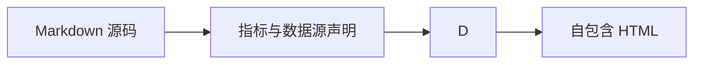

# drender-report

创建或编辑可移植的 `md-report/1` 分析报告或仪表盘时使用此 Skill。将源 Markdown、其中声明的 SQLite 数据库和引用的 `.sql` 文件放在一起，保证结果可复现、可编辑。

## 先规划分析问题与版式

先明确读者需要据此做出什么决策。把需求归纳成一个核心问题，必要时再补充少量辅助问题。保留目标读者、时间范围、对比基准和要求的细节程度。不要臆造缺失字段，也不要声称数据无法支持的结论；说明还需要哪些数据。

选择组件前先检查现有数据：

| 分析问题 | 数据形态 | 推荐视图 |
| --- | --- | --- |
| 某项指标随时间如何变化？ | 有序时间字段和数值指标 | 使用 `chart` 的 `line` 类型；重点展示累计规模或体量时用 `area`。 |
| 哪些分组更高或更低？ | 分类字段和数值指标 | 使用 `chart` 的 `bar`/`column` 类型；只需比较顺序时用 `ranking`。 |
| 总体由哪些部分构成？ | 分母和周期相同的分类数据 | 少量部分用 `chart` 的 `pie` 类型；部分较多时用 `treemap`；只需排序时用 `ranking`。 |
| 转化在哪些有序阶段流失？ | 带计数或比率的有序漏斗阶段 | 使用 `chart` 的 `funnel` 类型；默认降序，`"sort":"none"` 会保留查询中的阶段顺序。 |
| 两项数值指标是否共同变化？ | 每条观测一行，包含两个数值字段 | 使用 `chart` 的 `scatter` 类型，并保留每条原始观测。 |
| 两个分类维度如何交叉？ | 两个分类字段和一个度量值 | 使用 `pivot`；需要用颜色深浅表示数值时用 `chart` 的 `heatmap` 类型。 |
| 哪些记录需要跟进？ | 含标识和属性的交易或事件明细 | 使用 `data-table`；问题关注汇总时先聚合再展示。 |
| 读者应采取什么行动，证据在哪里？ | 少量结论及其对应图表 | 使用 `findings`，通过 `evidence` 链接到声明了 `anchor` 的图表。 |

根据阅读任务选择文档模式，而不是根据数据来源选择：

- **仪表盘：** 用于监控少量当前指标并快速发现异常。它是全屏深色看板。先放核心 KPI，再将主要趋势或对比放进最大面板，随后展示一两个有用的拆分和紧凑的明细表。较长的说明、方法、SQL 和次要分析应放在配套报告中。
- **报告：** 用于解释发生了什么及其原因、比较多个维度、查看记录或复核假设与限制。按文档阅读顺序组织：摘要与发现、支撑图表、相关明细，最后是解读、限制和方法。
- **两者都需要：** 同时要求监控和解释时，分别制作精简仪表盘与配套报告，并使用兼容的数据快照。不要把长报告塞进仪表盘面板。

每个业务数字只在文档头的 `metrics` 中声明一次，再从正文、KPI 卡片、图表和表格中引用。这样同一指标不会出现多个数值，读者也能同时看到指标定义。

正文至少有两个 H2–H4 标题时，报告会自动显示可点击目录；仪表盘不显示目录。默认设置 `toc: auto` 会在宽度达到 900 px 时展开目录，在窄屏上折叠目录。使用有描述性的分节标题，方便读者浏览长报告并跳转。

对支持的内容使用内置开源渲染器，不要用自定义 HTML 重造语法或视觉效果：`markdown-it-anchor` 和 `markdown-it-toc-done-right` 生成报告标题链接与目录；AntV T8 渲染 `antv-t8` 叙述；Apache ECharts 渲染图表；Tabulator 渲染数据表。Markdown 组件必须使用声明式写法，并符合渲染器支持的输入结构。

渲染前检查每个面板是否回答了明确的问题、图表编码是否适合数据、单位和周期是否可见，以及重复信息是否有明确用途。折线、条形、柱形、面积、漏斗、组合、瀑布和饼图的数据应先聚合，保证每个绘制坐标或分类只有一行。渲染器会拒绝重复坐标，不会静默丢弃观测。数值散点图允许 x 值重复；`boxplot` 会从原始行自行计算分位数。

## 文档结构与组件

从 YAML 文档头开始。格式、模式、标题、指标定义、数据源和面向读者的页面信息都必须放在这里：

```yaml
---
format: md-report/1
mode: report
title: 月度经营复盘
---
```

| 文档头字段 | 类型 | 说明 |
| --- | --- | --- |
| `format` | `md-report/1` | 必填。 |
| `mode` | `report`、`dashboard` | 必填。 |
| `title` | 字符串，最多 120 个字符 | 必填。不要再用 H1 重复标题；仪表盘会把它显示在顶部栏。 |
| `sqlite` | 映射 | 一个相对于工作区的数据库，以及 `datasets` 和/或 `scenes`。详见“准备和保护数据”。 |
| `assets` | 映射 | 资源 ID 对应工作区相对图片 `path` 和 `mediaType`。 |
| `metrics` | 映射 | 命名指标定义；详见“声明指标”。 |
| `eyebrow`、`deck`、`status`、`footer` | 字符串，最多 200 个字符 | 面向读者的页面信息；为空时省略。`eyebrow` 默认使用内置标签；`status` 显示在仪表盘顶部栏。 |
| `toc` | `auto`、`open`、`collapsed` | 默认值为 `auto`。 |
| `theme` | `auto`、`light`、`dark` | 默认值为 `auto`，跟随读者系统设置，并在报告模式显示切换按钮。仪表盘始终使用深色主题。 |

任何其他文档头字段都会报错。只有正文恰好包含一个顶层 `:::: dashboard columns=12` 容器时才使用 `mode: dashboard`。使用 `::: panel span=1` 到 `::: panel span=12` 声明平铺面板，每个面板用 `:::` 结束，整个仪表盘用 `::::` 结束。窄屏上面板会自动纵向堆叠。

全局基础字号默认为 14 px。宿主支持渲染字号选项时，可用 12–20 px 一并缩放报告、仪表盘、表格和图表文字。

正文可以包含：

- 标准 Markdown 标题、段落、引用、列表、围栏代码、链接和较小的管道表格。
- 提示框：`::: note`、`::: warning` 和 `::: success`，均以 `:::` 结束。
- 布局：以独占一行的 `]` 结束的 `[column` 分栏块，以及同样以 `]` 结束的 `[details summary` 折叠块（追加 `open` 可让折叠块默认展开）。
- JSON 围栏中的数据组件：`kpi`、`chart`、`data-table`、`ranking`、`pivot`、`findings`、`provenance`、`quality`。
- 图表与叙述围栏：`sql`、`mermaid`、`infographic`、`antv-t8`、`excalidraw`。
- 通过 `` 引用的栅格图片，并在文档头 `assets` 中声明相应资源。

每个 JSON 组件都会按下方表格校验允许的键。其他键会触发 `component.unknown-key`，拼写错误不会再悄悄丢弃字段。围栏属性仅允许 `dialect=`、`title="..."`、`kicker="..."` 和单独的 `engine` 标记；其他属性都会触发 `component.info-token`。

## 声明指标

指标只在文档头中声明一次，再通过 `{{metric_id}}` token、`metricRef`（KPI 项、图表、排行、发现卡）和 `formatRef`（表格列）引用。指标 ID 必须符合 `[A-Za-z][A-Za-z0-9._-]{0,127}`。每项指标只能使用字面量 `value`，或 `dataRef` + `field` 绑定；两种来源不能同时设置。绑定会读取对应数据集的第一行。

```yaml
metrics:
  oct_revenue:
    label: 10 月营收
    dataRef: summary
    field: revenue_total
    format: currency
    currency: CNY
    compact: true
    goodDirection: up
    comparison:
      kind: mom
      dataRef: summary
      field: revenue_prev
      period: 环比
    definition: 当月已支付订单金额合计
    numerator: 各区域已支付订单金额
    denominator: 月度营收合计
    source: 交易库 regional_revenue
    asOf: '2026-10-31'
    owner: 经营分析组
```

| 指标字段 | 类型 | 说明 |
| --- | --- | --- |
| `label` | 字符串 | 展示名称；默认使用指标 ID。 |
| `value` | 有限数值或字符串 | 字面量。不能与 `dataRef`/`field` 同时使用。 |
| `dataRef` | 数据集 ID | 必须在本报告中物化。 |
| `field` | 非空字符串 | 对应数据集第一行中的列。 |
| `format` | `number`、`currency`、`percent`、`percentage-points`、`ratio`、`date`、`text` | 展示格式。`date` 和 `text` 会原样显示数值。 |
| `currency` | 三位 ISO 4217 代码 | 仅与 `format: currency` 搭配；默认 `CNY`。 |
| `decimals` | 0–6 的整数 | 小数位数。默认值：百分比和百分点为 1；货币为 0（`compact` 时为 1）；比率为 2；紧凑数值为 1；其他数值整数为 0、小数为 2。 |
| `unit` | 字符串 | 追加在数值后；中日韩文字单位前不加空格。Token 和发现卡会显示单位；KPI 卡会在数值单位位置显示。 |
| `compact` | 布尔值 | 使用紧凑计数法，例如 `1007000` 显示为 `100.7万`。 |
| `scale` | 有限数值 | 展示前乘以该系数。 |
| `goodDirection` | `up`、`down`、`neutral` | 哪个变化方向算作正向。`down` 可让退款率下降显示为正向；默认 `up`。 |
| `comparison` | 映射 | 基准值和周期，见下文。 |
| `definition`、`numerator`、`denominator`、`source`、`asOf`、`owner` | 字符串 | 提供给 `provenance` 组件展示的指标来源信息。 |

`comparison` 仅接受 `kind`、`value`、`dataRef`、`field`、`asPercent`、`pointsDelta` 和 `period`：

| 对比字段 | 类型 | 说明 |
| --- | --- | --- |
| `kind` | `mom`、`yoy`、`target`、`none` | 存在基准值时默认 `mom`。`none` 会隐藏变化方向。 |
| `value` | 有限数值 | 字面量基准值。不能与 `dataRef`/`field` 同时使用。 |
| `dataRef`、`field` | 数据集 ID 和列名 | 从另一个已声明数据集的第一行读取基准值。 |
| `asPercent` | 布尔值 | 可接受。默认已经按比率计算；改变计算方式时使用 `pointsDelta`。 |
| `pointsDelta` | 布尔值 | 按百分点绝对差计算，不按比率计算。 |
| `period` | 字符串 | 周期标签。`mom` 默认为 `环比`，`yoy` 默认为 `同比`，`target` 默认为 `较目标`。 |

`format: percent` 显示比率；`format: percentage-points` 显示差值并追加 `pp`。不设置 `pointsDelta` 时，变化量为 `value / baseline − 1`，以百分比显示；设置 `pointsDelta: true` 时，变化量为 `value − baseline`，以 `pp` 显示。占比或费率本身变化时使用百分点；关注相对变化时使用比率。

声明 `denominator` 的指标会加入占比组：使用相同分母字符串且格式为 `percent` 或 `ratio` 的指标，其合计必须在 1 的 ±0.005 范围内，否则校验会报告 `metric.share-sum`。这样可以发现明细加总后不再等于整体的情况。

`{{metric_id}}` 会在普通正文以及 `antv-t8`、`infographic`、`mermaid` 围栏中替换为带单位的格式化数值。无法解析的 token 属于错误（`metric.token-unresolved`）。`antv-t8` 叙述没有引用指标 token 时，只会警告 `t8.metric-token-missing`，提示其中的数字是硬编码值。T8 链接同时显示指标 token 并声明 `origin=` 时，两者必须对应同一指标。

## 组件字段说明

### `kpi` — 核心指标卡

用途：让读者一眼看到少量关键数值、单位和对比结果。

块级字段：`items`（1–12 个对象）、`title`、`kicker`。

```kpi
{"title":"关键指标","kicker":"指标摘要","items":[
{"metricRef":"revenue_total","sparkline":{"dataRef":"monthly_total","x":"month","y":"revenue","title":"月度营收趋势"}},
{"label":"10 月营收","dataRef":"summary","field":"revenue_total","format":"currency","compact":true,"changeField":"revenue_mom","changeFormat":"percent","period":"环比"},
{"metricRef":"paid_orders"},
{"label":"单笔上限","value":5000,"format":"currency:CNY"}]}
```

| 项字段 | 类型 | 说明 |
| --- | --- | --- |
| `metricRef` | 指标 ID | 从指标定义中读取数值、单位、格式和对比。不能与 `value`、`dataRef`、`field` 或 `changeField` 同时使用。 |
| `label` | 字符串 | 必填；若 `metricRef` 指向的指标已声明标签，则可以省略。 |
| `value` | 有限数值或字符串 | 字面量数值。 |
| `dataRef` + `field` | 数据集 ID + 列名 | 数据集必须恰好返回一行汇总数据，且其中必须存在该列。 |
| `change` | 有限数值 | 字面变化比率，例如 `0.05` 显示为 `+5.0%`。不能与 `changeField` 同时使用。 |
| `changeField` | 字符串列名 | 从 `dataRef`/`field` 对应的同一汇总行读取数值比率。 |
| `changeFormat` | `percent`、`percentage-points` | 变化量的显示方式，默认为 `percent`。 |
| `period` | 字符串 | 字面周期标签，默认为 `环比`。不能与 `periodField` 同时使用。 |
| `periodField` | 字符串列名 | 从同一汇总行读取文本周期。 |
| `direction` | `positive`、`negative`、`neutral` | 强制指定对比颜色。可与 `change`/`changeField` 同时使用，并优先于自动判断。 |
| `goodDirection` | `up`、`down`、`neutral` | 未设置 `direction` 时，指定哪种变化方向为正向；也适用于从 `metricRef` 继承的值。 |
| `format`、`currency`、`decimals`、`compact`、`scale` | 同指标定义 | 为字面量或 `dataRef`/`field` 项覆盖显示格式。 |
| `unit` | 字符串 | 覆盖卡片显示的单位。 |
| `sparkline` | 映射 | `{"dataRef","x","y","title"}` 绘制内嵌 SVG 趋势线；数据集至少需要两行。 |
| `anchor` | 字符串 | 卡片稳定的页内锚点 ID。 |

每个项必须且只能有一种数值来源：`metricRef`、字面量 `value` 或 `dataRef` + `field`。`changeField` 和 `periodField` 需要 `dataRef`/`field` 绑定，且对应列必须存在于汇总行中。

### `chart` — 趋势、构成及特殊图表

用途：展示数值沿某个维度的变化、整体构成，或数据分布形态。

块级字段：`kind`、`dataRef`、`x`、`y`、`series`、`title`、`unit`、`kicker`、`metricRef`、`axisFormat`、`anchor`、`targets`、`bands`、`points`，以及图表类型专用字段 `value`、`name`、`mapName`、`geo`、`open`、`high`、`low`、`close`、`volume`、`source`、`target`、`totalField`、`sort`、`min`、`max`。

```chart
{"kind":"line","title":"月营收走势（按区域）","dataRef":"monthly_by_region","x":"month","y":"revenue","series":"region","unit":"元","anchor":"revenue-trend"}
```

`dataRef` 必填，且 `x` 和 `y` 必须是数据集中的字段。使用 `metricRef` 时，`y` 和 `unit` 会从指标定义读取，不要再声明这两个字段。多系列 `line`/`area` 图表的 `series` 是字段名；`combo` 图表的 `series` 是系列对象数组。`axisFormat` 接受 `format`、`decimals`、`compact`、`currency` 和 `scale`，用于覆盖数值轴格式。

| 类型 | 必填字段 | 说明 |
| --- | --- | --- |
| `line`、`bar`、`column`、`area` | `x`、`y`（或 `metricRef`） | 每个 x/系列坐标一行。`series` 用于拆分多条曲线。 |
| `scatter` | `x`、`y`（或 `metricRef`） | 所有 x 值均可解析为数值时使用数值轴；允许 x 值重复。 |
| `pie` | `x`、`y`（或 `metricRef`） | 每个分类一行；不允许分类重复。 |
| `funnel` | `x`、`y` | `"sort":"none"` 保留查询的阶段顺序；默认按降序排列。 |
| `combo` | `x`、`series`（1–6 项） | 双轴组合图；每个 x 值一行。 |
| `waterfall` | `x`、`y` | `totalField` 指定一个真值列，用于标记总计行。 |
| `candlestick` | `x`、`open`、`high`、`low`、`close` | 可选 `volume` 会增加副轴和缩放条。 |
| `boxplot` | `x`、`y` | 在浏览器中计算分位数；请提供原始行。 |
| `heatmap` | `x`、`y`、`value` | `x` 和 `y` 是分类轴，`value` 表示强度。 |
| `sankey` | `source`、`target`、`y` | 展示从源节点流向目标节点的数量。 |
| `treemap` | `x`、`y` | 展示各部分的相对规模。 |
| `radar` | `x`、`y` | `x` 是维度，`y` 是分值；可用 `series` 对多组多边形分组。 |
| `gauge` | `y` 或 `value` | 使用 `min`（默认 0）和 `max`（默认 100）设置范围。 |
| `map` | `name`、`value`、`geo` | `geo` 是内嵌 GeoJSON 对象。几何数据随文档一起保存以支持离线导出；真实部署需自行提供 GeoJSON。 |

```chart
{"kind":"combo","title":"营收与华东集中度","dataRef":"monthly_share","x":"month","unit":"元","axisFormat":{"format":"currency","compact":true},"series":[{"field":"revenue","type":"bar","axis":0,"name":"月度营收"},{"field":"share_east","type":"line","axis":1,"name":"华东占比","format":"percent"}]}
```

| `combo` 系列字段 | 类型 | 说明 |
| --- | --- | --- |
| `field` | 字符串 | 数据集中的数值列。 |
| `type` | `line`、`bar`、`area` | 默认 `line`。 |
| `axis` | `0`、`1` | 系列使用的数值轴；默认 0。 |
| `name` | 字符串 | 图例标签；默认使用字段名。 |
| `stack` | 布尔值或字符串 | 堆叠具有相同值的系列；字符串用于命名堆叠组。 |
| `format`、`decimals`、`compact` | 同指标定义 | 单个系列的数值格式。 |

笛卡尔坐标系、`combo` 和 `waterfall` 图表还支持三类标注。每类最多包含 20 项：

| 标注层 | 字段 | 说明 |
| --- | --- | --- |
| `targets` | `value`（必填）、`label`、`axis`（`x`/`y`）、`color` | 虚线参考线。 |
| `bands` | `from`、`to`（必填）、`axis`（`x`/`y`）、`label` | 阴影区间。 |
| `points` | `x`、`y`（必填）、`text` | 带标签的标记点；不允许设置 `axis`。 |

```chart
{"kind":"line","title":"华东占比趋势","dataRef":"monthly_share","x":"month","y":"share_east","unit":"比例","axisFormat":{"format":"percent"},"anchor":"region-concentration","targets":[{"value":0.5,"label":"50% 参考线"}]}
```

报告模式下图表容器高度为 250 px；在仪表盘面板中，图表会填满整个面板。

### `data-table` — 行级明细

用途：展示需要检查、排序或导出的记录。

块级字段：`dataRef`、`title`、`kicker`、`anchor`、`columns`、`defaultSort`、`viewportHeight`、`exportable`、`updatedAt`。

```data-table
{"dataRef":"regional_revenue","title":"区域明细","kicker":"数据表","columns":[{"field":"region","label":"区域","width":120,"frozen":true},{"field":"orders","label":"订单数","format":"number","sorter":"number"},{"field":"revenue","label":"营收","formatRef":"region_revenue","minWidth":140}],"defaultSort":{"field":"revenue","direction":"desc"},"viewportHeight":320,"exportable":true,"updatedAt":"2026-10-31"}
```

| 块级字段 | 类型 | 说明 |
| --- | --- | --- |
| `dataRef` | 数据集 ID | 必填。 |
| `columns` | 非空数组 | 省略时显示数据集中的所有列。 |
| `defaultSort` | `{field, direction}` | `direction` 为 `asc` 或 `desc`（默认 `asc`）；字段必须是当前显示的列。 |
| `viewportHeight` | 数值 | 默认 480；超出 160–1200 时会发出警告并限制在范围内。 |
| `exportable` | 布尔值 | 默认 `true`。显示导出控件，并通过礼貌式实时区域反馈；设为 `false` 时隐藏控件。 |
| `updatedAt` | 字符串 | 覆盖来源信息行中的数据集更新时间。 |
| `anchor` | 字符串 | 稳定的页内锚点 ID。 |

| 列字段 | 类型 | 说明 |
| --- | --- | --- |
| `field` | 字符串 | 必填，必须存在于数据集中，且不能重复。 |
| `label` | 字符串 | 表头文字；默认使用字段名。 |
| `format` | `currency:CNY`、`percent`、`percentage-points`、`compact`、`number` | 单元格格式。`currency:` 后可使用任意 ISO 4217 货币代码。 |
| `formatRef` | 指标 ID | 复用指定指标的 `format`。 |
| `width`、`minWidth` | 正数 | 列宽，单位为像素。 |
| `frozen` | 布尔值 | 滚动时固定显示该列。 |
| `sorter` | 字符串 | Tabulator 排序器名称；样本为数值时默认 `number`，否则默认 `string`。 |

最多显示 5,000 行。

### `ranking` — 排序列表

用途：无需完整坐标轴时，展示谁领先以及领先幅度。

字段：`dataRef`、`x`、`y`、`title`、`kicker`、`anchor`、`limit`、`format`、`currency`、`unit`、`decimals`、`compact`、`share`、`metricRef`。

```ranking
{"dataRef":"regional_revenue","x":"region","y":"revenue","title":"区域营收排行","kicker":"排行","limit":3,"format":"currency","compact":true,"share":true,"anchor":"region-ranking"}
```

`dataRef` 和 `x` 必填。数值来自 `y` 或 `metricRef`，二者不能同时使用；`metricRef` 指向的指标必须读取此块声明的数据集。`limit` 范围为 1–50，默认 10。`share` 默认 `true`，会显示每行占总量的比例。格式字段与指标定义相同。

### `pivot` — 交叉表

用途：展示两个分类维度的交叉结果。

字段：`dataRef`、`rows`、`columns`、`value`、`agg`、`title`、`kicker`、`anchor`、`format`、`currency`、`unit`、`decimals`、`compact`、`rowTotal`、`columnTotal`、`metricRef`、`rowsLabel`、`columnsLabel`。

```pivot
{"dataRef":"region_month","rows":"region","columns":"month","value":"revenue","agg":"sum","title":"区域与月份营收","kicker":"交叉表","format":"currency","compact":true,"rowTotal":true,"columnTotal":true}
```

`dataRef`、`rows`、`columns` 和 `value` 均必填，且每个字段都必须存在。`agg` 可选 `sum`、`avg`、`min`、`max`、`count` 或 `first`，默认 `sum`；除非 `agg` 为 `count`，否则每行的 `value` 都必须是数值。`rowTotal` 默认 `true`，`columnTotal` 默认 `false`。`rowsLabel` 和 `columnsLabel` 默认使用字段名。`metricRef` 会复用指标格式，但 `value` 仍需在当前块中声明。

### `findings` — 按严重程度标注的结论

用途：指出读者应采取的行动及其证据所在。

块级字段：`title`、`kicker`、`anchor`、`items`（1–12 个对象）。

```findings
{"title":"发现卡与证据锚点","kicker":"发现","items":[
{"severity":"info","title":"anchor 让证据可跳转","detail":"图形声明 anchor 后会生成页内锚点；发现卡的 evidence 填入锚点 id 即可链接过去。","evidence":["revenue-trend"]},
{"severity":"risk","title":"必需字段缺失会直接校验失败","detail":"chart 与 data-table 必须声明 dataRef。","action":"按各节语法逐项补齐必需键","owner":"报告作者"}]}
```

| 项字段 | 类型 | 说明 |
| --- | --- | --- |
| `title` | 字符串 | 必填。 |
| `severity` | `risk`、`opportunity`、`info`、`positive` | 颜色类别；默认 `info`。 |
| `detail` | 字符串 | 补充说明。 |
| `metricRef` | 指标 ID | 显示带单位的格式化指标值。 |
| `evidence` | 锚点 ID 数组 | 每项都会链接到声明该锚点的组件中的 `#anchor`。 |
| `action`、`owner` | 字符串 | 显示为包含负责人的行动项。 |

### `provenance` — 指标口径附录

用途：说明各项数字的来源和负责人。

字段：`title`、`kicker`、`anchor`、`items`。

```provenance
{"title":"指标口径附录","kicker":"口径"}
```

省略 `items` 时会列出所有已声明指标。`items` 是指标 ID 数组，其中每项都必须已声明。表格列取自 `definition`、`numerator`/`denominator`、`source`、`asOf` 和 `owner`。

### `quality` — 数据集健康度

用途：检查数据是否完整、及时，数据规模是否符合预期。

字段：`title`、`kicker`、`anchor`、`dataRefs`、`notes`。

```quality
{"dataRefs":["summary","regional_revenue","order_details"],"title":"数据质量","kicker":"质量","notes":["省略 dataRefs 时列出全部已声明数据集。"]}
```

`dataRefs` 是已物化数据集 ID 数组；省略时会检查所有已声明数据集。组件会计算行数、列数、存在缺失值（空字符串或 null）的列，并显示来源、更新时间和读取时间。`notes` 是字符串数组，用来补充数量统计无法表达的限制。

### `sql` — 仅展示查询文本

用途：展示用于复核报告数字的查询语句。

````markdown
```sql dialect=sqlite title="区域营收与占比"
SELECT region, revenue
FROM regional_revenue
ORDER BY revenue DESC
```
````

`dialect` 可选 `standard`（默认）、`postgresql`、`mysql`、`bigquery`、`duckdb` 或 `sqlite`。查询只会格式化后展示，渲染器不会执行它。报告若附带复核查询，应先确认该查询能在声明的数据库上运行。

### `mermaid`、`infographic`、`antv-t8` — 图表与叙述

这三种围栏包含自然语言正文，因此其中的 `{{metric_id}}` token 会被解析。



```infographic title="信息图清单" kicker="信息图"
infographic list-row-simple-horizontal-arrow
data
  lists
    - label: 指标 token 在信息图内解析
      desc: 例如 {{revenue_total}}
```

```antv-t8 title="一段话结论"
10 月营收为[{{oct_revenue}}](metric_value)，环比[{{revenue_mom}}](ratio_value, assessment="positive")。
```

使用项目锁定版本的 Mermaid 所支持的图表类型和语法，并保持 `securityLevel: strict`。选择与内容结构相符的 Infographic 模板，并提供模板要求的数据。T8 支持指标、比率、差值、趋势、分布、排名和异常实体；链接只能使用完整的 `http://` 或 `https://` 地址，不支持以根目录开头的相对路径。

### `excalidraw` — 业务关系示意图

用途：用图示而不是文字说明实体之间的关系。

```excalidraw
{"sceneRef":"conversion_flow","title":"内容到支付的主链路","kicker":"业务关系图"}
```

场景存放在 SQLite 数据源中时使用 `sceneRef`；也可以直接提供官方场景对象，并设置 `type: "excalidraw"` 和 `elements` 数组。场景中的图片必须使用内嵌的 `data:image` URL，保证导出文件可离线使用。写出 HTML 前，场景会先转换为静态 SVG。

## 准备和保护数据

可复用的报告应在 Markdown 文档头中声明一个 SQLite 数据库。使用 SQL 时，为每个数据集来源指定 `table` 或 `tables`；读取 SQLite 视图时指定 `view` 名称。可以声明列类型，但数据源必须且只能选择一种：相对于工作区的 `queryFile`、命名的 SQLite `view` 或内联 `query`。可复用或多行查询应放入 `.sql` 辅助文件，内联写法只保留给简短的一次性查询。绑定值放在 `parameters` 中，不要拼接进 SQL 字符串。Excalidraw 的 `sceneRef` 使用相同的数据源选项；需要时通过 `column` 指定存有 JSON 结果的列。DSH 适配器会在当前会话工作区中解析所声明的文件，以只读方式运行查询，物化一致的数据快照，然后执行校验和渲染。请将 Markdown、数据库和 `.sql` 文件放在同一项目中：

```yaml
sqlite:
  path: data/monthly-review.sqlite
  datasets:
    monthly_revenue:
      table: monthly_revenue
      queryFile: queries/monthly-revenue.sql
      columns:
        - name: month
          type: string
        - name: region
          type: string
        - name: revenue
          type: number
          unit: CNY
  scenes:
    process_flow:
      table: report_scenes
      queryFile: queries/process-flow-scene.sql
      column: scene_json
```

若要读取数据库视图，请声明 `view: monthly_revenue_report`，并省略 `query`/`queryFile`。该视图必须已存在于 SQLite 文件中。很短的一次性查询可以直接使用 `query: SELECT ...`。同一个数据源不能混用这些选项。

正文可以直接引用数据和场景，无需复制其内容：

````markdown
```chart
{"kind":"line","dataRef":"monthly_revenue","x":"month","y":"revenue","series":"region"}
```

```excalidraw
{"sceneRef":"process_flow"}
```
````

根据报告是否需要复现，选择合适的数据传递方式：

- 使用 DSH 的 `path` 参数读取现有 `.md` 文件，避免通过工具参数重复传输整份 Markdown。HTML 会写在 Markdown 旁边，文件名包含内容哈希；工具会返回源文件和 HTML 的绝对路径。编辑源文件后再次调用工具即可重新渲染。
- 新建、尚未保存或很短的一次性报告可使用 `markdown` 参数。`markdown` 和 `path` 必须且只能提供一个。
- 只有在制作小型一次性快照，或其他宿主已有内存快照时，才内联提供 `datasets`（或 CSV 数据）。内联数据不会写入 Markdown，在 DSH 中会触发可移植性警告，并计入 1 MB 数据集总量限制。
- 需要复现、定期更新、执行 SQL 联接或聚合，或不应复制到提示词中的数据，应使用 Markdown 文档头中的 SQLite 数据源。可复用 SQL 放入 `.sql` 辅助文件或数据库视图。导出的 HTML 会嵌入一次物化的数据快照；更新数据库后需重新渲染才能反映变化。

在 DSH 中，数据库和 `.sql` 文件路径相对于当前会话工作区，不能越出工作区，并且需要 DSH 文件系统服务。每份报告只能声明一个 SQLite 文件。查询必须以 `SELECT`、`WITH` 或 `VALUES` 开头；数据库以只读方式打开，查询参数单独绑定，SQL 文件不得超过 100 KB，每个数据集最多返回 5,000 行。`sqlite` 文档头以外的 SQL 代码围栏也不会执行。文档头记录数据源表名和 query-file/view 引用；可复用查询逻辑存放在辅助 SQL 文件或 SQLite 视图中。

图片文件应保存在当前工作区，并明确声明每个工作区相对路径。图片是独立文件，不是 SQLite 二进制对象；导出的 HTML 只会把已声明的图片嵌入为 data URI，因此可以离线使用，也可与 Markdown 源文件和数据库一起分享：

```yaml
assets:
  company_mark:
    path: assets/company-mark.png
    mediaType: image/png
```

在正文中使用 `` 引用图片。DSH 会在会话工作区内解析路径，并对其实施与其他本地资源相同的目录范围和大小限制。不支持从文档头读取资源的宿主，可以直接通过 `ReportDocument.assets` 提供等价的图片字节。

不支持从 Markdown 读取 SQLite 的其他宿主，应在调用渲染器前解析已声明的数据源，并将快照放入 `ReportDocument.datasets` 和 `ReportDocument.scenes`。在 DSH 中，内联 `datasets` 和 `assets` 工具参数只适合一次性报告：适配器会保存 Markdown 源文件，但不会把这些内联值写入其中，因此会发出可移植性警告。CSV 仍适合一次性数据，使用相同的数据集结构：

- 需要增量更新、历史记录、索引、联接或可复现查询的周期性数据优先使用 SQLite。
- 一次性上传、交接或小型静态数据优先使用 CSV 工具参数。若需要稳定解析数值或布尔值，请声明列类型。
- 渲染后的 HTML 嵌入的是物化快照，不是实时数据库连接。源数据更新后，必须重新读取数据并再次渲染。
- 将文档头中的数据库路径、查询文件路径和 SQL 视为不可信文档输入：宿主必须限制工作区范围、只读访问和查询规模，并绑定参数。凭据和有权限的本地路径应放在可信宿主配置中。SQL 代码围栏仅用于展示。
- 当前渲染器最多接受 1 MB 已声明数据集，最多显示 5,000 行表格数据。较大的输入应在渲染前聚合或筛选，并说明省略的数据范围。

`drender_validate` 会返回每个数据集物化后的行数和 UTF-8 字节数。数据集达到 4,000 行，或数据集快照总量达到 800,000 字节时会发出警告；硬性上限为每条 SQLite 查询 5,000 行、数据集总量 1,000,000 字节。校验最多返回 500 条诊断。它会收集相互独立的问题，但组件格式错误时可能跳过依赖该组件的检查（例如，图表 JSON 无效时就无法检查字段引用）。

渲染器会拒绝原始 HTML，只允许 `https:`、`http:`、`mailto:` 和文档内锚点链接，并且只嵌入已声明的栅格图片。它不会执行用户 JavaScript 或 SQL。导出的 HTML 包含 CSS 和报告实际需要的图表、表格、Mermaid、T8、Infographic 运行时；交付前，Excalidraw 场景会转换为 SVG。估算文件大小时，可按包含图表时 ECharts 约 1.1 MB、包含数据表时 Tabulator 约 0.5 MB 计算。两者都存在的报告，在加入数据和其他内容前通常约为 1.6–1.7 MB。运行时会内嵌，以保证文档离线可用；隐藏图表控件不会明显降低这个大小下限。收到 HTML 的人都能检查其中嵌入的数据，请勿在报告中放入秘密信息。

## 渲染流程

1. 准备包含 `markdown` 的 `ReportDocument`，必要时再提供声明的数据集 `datasets` 和内联图片 `assets`。DSH 可以直接从 Markdown 文档头读取 SQLite 和图片文件。处理工作区中已有的 Markdown 文件时，给 DSH 传入 `path`，不要重新发送整段文本。
2. 宿主提供 md-report 校验工具时优先使用。渲染前修复所有错误诊断。未知组件字段、无法解析的指标 token 和缺少必填字段都属于错误，不是警告。
3. 宿主提供渲染工具时使用该工具。否则，在源码工作区中调用 `validateReport(document)` 和 `renderReport(document, options)`。
4. 在 DSH 中，`drender_render` 会返回数据集行数与字节数、组件摘要，以及 HTML 和源文件的绝对路径。传入 `path` 时，它会在源 Markdown 旁写出文件名含内容哈希的 HTML；传入内联 Markdown 时，它会在当前会话工作区保存本次调用对应的源文件副本。Markdown、SQLite 数据库、引用的 `.sql` 文件和声明路径下的图片共同构成可复现源文件，应一并保留。导出的 HTML 只是可查看的快照。如果其他宿主无法保存源文件，请返回或保存 Markdown，并说明必须与它一起提供的辅助文件。
