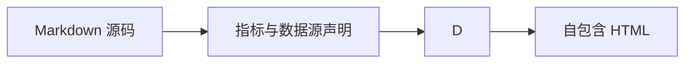

# drender-report

Use this skill when creating or editing an analytical report or dashboard in the portable `md-report/1` format. Keep the source Markdown, its declared SQLite database, and any referenced `.sql` files together so the output remains reproducible and editable.

## Plan the analysis and layout first

Start with the decision the reader needs to make. Turn the request into one primary question and, when useful, a small number of supporting questions. Preserve the audience, time range, comparison baseline, and requested level of detail. Do not invent missing fields or claim conclusions the data cannot support; state what additional data is needed.

Inspect the available data before choosing components:

| Analysis question | Data shape | Recommended view |
| --- | --- | --- |
| How is a measure changing over time? | Ordered time field plus numeric measures | `chart` kind `line`; use `area` when accumulated volume or magnitude is the focus. |
| Which groups are higher or lower? | Categories plus a numeric measure | `chart` kind `bar`/`column`, or `ranking` when only the order matters. |
| How is a whole divided among parts? | Categories sharing the same denominator and period | `chart` kind `pie` for a few parts, `treemap` for many, `ranking` for a sorted list. |
| Where does conversion fall between ordered stages? | Ordered funnel stages with counts or rates | `chart` kind `funnel`; the default sort is descending, and `"sort":"none"` keeps the query's stage order. |
| Do two numeric measures move together? | One row per observation with two numeric fields | `chart` kind `scatter`. Preserve individual observations. |
| How do two categories cross? | Two categorical fields plus one measure | `pivot`; use `chart` kind `heatmap` when the value should read as intensity. |
| Which records need follow-up? | Transaction/event rows with identifiers and attributes | A `data-table`; summarize first when the question is aggregate. |
| What should the reader act on, and where is the evidence? | A handful of conclusions tied to named charts | `findings` with `evidence` anchors into charts declared with `anchor`. |

Choose the document mode from the reading task, not from the data source:

- **Dashboard:** use it to monitor a small set of current metrics and spot exceptions at a glance. It is a full-screen dark wallboard. Put headline KPIs first, the primary trend or comparison in the largest panel, then one or two useful breakdowns and a compact detail table. Keep long explanations, methodology, SQL, and secondary analyses in a companion report.
- **Report:** use it to explain what happened and why, compare several cuts, inspect records, or review assumptions and caveats. Use a document flow: summary and findings, supporting charts, relevant detail, then interpretation, limitations, and method.
- **Both:** when monitoring and explanation are both requested, create a concise dashboard and a separate report with compatible data snapshots. Do not squeeze a long report into dashboard panels.

Declare each business number once in frontmatter `metrics` and reference it from prose, KPI cards, charts, and tables. A metric cannot then appear as two different values, and the reader-facing definition travels with it.

Reports automatically show a clickable table of contents when the body has at least two H2–H4 headings; dashboard layouts never include one. `toc: auto` (the default) expands it at 900 px and wider and collapses it on narrow screens. Use descriptive section headings so readers can scan and jump through long reports.

Use the bundled open-source renderers for supported content instead of recreating their syntax or visuals in custom HTML: `markdown-it-anchor` and `markdown-it-toc-done-right` generate report heading links and the table of contents, AntV T8 renders `antv-t8` narratives, Apache ECharts renders charts, and Tabulator renders data tables. Keep Markdown components declarative and within the renderer's supported input schema.

Before rendering, check that each panel answers a named question, chart encodings fit the data, units and periods are visible, and repeated information has a clear purpose. Aggregate line, bar, column, area, funnel, combo, waterfall, and pie data upstream to one row per plotted coordinate or category. The renderer rejects duplicate coordinates rather than silently dropping observations. Numeric scatter charts preserve repeated x values, and `boxplot` computes its own quantiles from raw rows.

## Document shape and components

Start with YAML frontmatter. It is the only place for the format, mode, title, metric definitions, data sources, and reader-facing chrome:

```yaml
---
format: md-report/1
mode: report
title: Monthly operating review
---
```

| Frontmatter key | Type | Notes |
| --- | --- | --- |
| `format` | `md-report/1` | Required. |
| `mode` | `report`, `dashboard` | Required. |
| `title` | string, ≤120 characters | Required. Do not repeat it as an H1; a dashboard shows it in the top bar. |
| `sqlite` | mapping | One workspace-relative database plus `datasets` and/or `scenes`. See Prepare and protect data. |
| `assets` | mapping | Asset ID → workspace-relative image `path` and `mediaType`. |
| `metrics` | mapping | Named metric definitions; see Declared metrics. |
| `eyebrow`, `deck`, `status`, `footer` | string, ≤200 characters | Reader-facing chrome, omitted when empty. `eyebrow` falls back to a built-in label; `status` renders in the dashboard top bar. |
| `toc` | `auto`, `open`, `collapsed` | Default `auto`. |
| `theme` | `auto`, `light`, `dark` | Default `auto`; follows the reader's system and renders a toggle in report mode. A dashboard is always dark. |

Any other frontmatter key is an error. Use `mode: dashboard` only when the body contains exactly one top-level `:::: dashboard columns=12` container. Use flat panels declared as `::: panel span=1` through `::: panel span=12`, each closed by `:::`, and close the dashboard with `::::`. The wallboard adapts to narrow screens by stacking panels.

The global base font defaults to 14 px. When the host supports a render font-size option, use 12–20 px to scale report, dashboard, table, and chart text together.

Body content:

- Standard Markdown headings, paragraphs, quotes, lists, fenced code, links, and small pipe tables.
- Callouts: `::: note`, `::: warning`, and `::: success`, closed by `:::`.
- Layout: `[column` blocks closed by a line containing `]`, and `[details summary` blocks (append `open` to start expanded) closed the same way.
- Data components in JSON fences: `kpi`, `chart`, `data-table`, `ranking`, `pivot`, `findings`, `provenance`, `quality`.
- Diagrams and narrative: `sql`, `mermaid`, `infographic`, `antv-t8`, `excalidraw`.
- Raster images referenced as `` with a matching `assets` frontmatter entry.

Every JSON component is validated against the allowed keys in the tables below. Any other key is rejected with `component.unknown-key`; a typo can no longer silently drop a field. Fence attributes are also restricted to `dialect=`, `title="..."`, `kicker="..."`, and the bare `engine` flag, and any other attribute is rejected with `component.info-token`.

## Declared metrics

A metric is declared once in frontmatter and referenced from `{{metric_id}}` tokens, `metricRef` (KPI items, charts, rankings, findings), and `formatRef` (table columns). Metric IDs must match `[A-Za-z][A-Za-z0-9._-]{0,127}`. A metric takes either a literal `value` or a `dataRef` + `field` binding, never both; the binding reads the first row of that dataset.

```yaml
metrics:
  oct_revenue:
    label: 10 月营收
    dataRef: summary
    field: revenue_total
    format: currency
    currency: CNY
    compact: true
    goodDirection: up
    comparison:
      kind: mom
      dataRef: summary
      field: revenue_prev
      period: 环比
    definition: 当月已支付订单金额合计
    numerator: 各区域已支付订单金额
    denominator: 月度营收合计
    source: 交易库 regional_revenue
    asOf: '2026-10-31'
    owner: 经营分析组
```

| Metric key | Type | Notes |
| --- | --- | --- |
| `label` | string | Display name; defaults to the metric ID. |
| `value` | finite number or string | Literal value. Mutually exclusive with `dataRef`/`field`. |
| `dataRef` | dataset ID | Must be materialized for this report. |
| `field` | non-empty string | Column in the first row of that dataset. |
| `format` | `number`, `currency`, `percent`, `percentage-points`, `ratio`, `date`, `text` | Display format. `date` and `text` render the raw value. |
| `currency` | three-letter ISO 4217 code | Only with `format: currency`; defaults to `CNY`. |
| `decimals` | integer 0–6 | Fraction digits. Defaults: percent and percentage points 1; currency 0, or 1 when `compact`; ratio 2; compact 1; otherwise 0 for integers and 2 for fractions. |
| `unit` | string | Appended after the value, without a space for CJK units. Tokens and findings include it; KPI cards show it in the value's unit slot. |
| `compact` | boolean | Compact notation: `1007000` renders as `100.7万`. |
| `scale` | finite number | Multiplies the value before display. |
| `goodDirection` | `up`, `down`, `neutral` | Which sign counts as good. `down` makes a falling refund rate read as positive; default `up`. |
| `comparison` | mapping | Baseline and period, below. |
| `definition`, `numerator`, `denominator`, `source`, `asOf`, `owner` | string | Reader-facing provenance for the `provenance` component. |

`comparison` accepts exactly `kind`, `value`, `dataRef`, `field`, `asPercent`, `pointsDelta`, and `period`:

| Comparison key | Type | Notes |
| --- | --- | --- |
| `kind` | `mom`, `yoy`, `target`, `none` | Defaults to `mom` when a baseline is present. `none` suppresses direction. |
| `value` | finite number | Literal baseline. Mutually exclusive with `dataRef`/`field`. |
| `dataRef`, `field` | dataset ID and column | Baseline read from the first row of another declared dataset. |
| `asPercent` | boolean | Accepted; a ratio is already the default, so `pointsDelta` is the key that changes the math. |
| `pointsDelta` | boolean | Compare as an absolute difference in percentage points instead of a ratio. |
| `period` | string | Period label. Defaults to `环比` for `mom`, `同比` for `yoy`, `较目标` for `target`. |

`format: percent` renders the ratio itself; `format: percentage-points` renders a difference and appends `pp`. Without `pointsDelta` the change is `value / baseline − 1` and renders as a percentage; with `pointsDelta: true` it is `value − baseline` and renders as `pp`. Use percentage points for a share or rate that moved, and a ratio when the relative change is the question.

A metric that names a `denominator` joins a share group: every metric sharing that same denominator string (with `percent` or `ratio` format) must sum to 1 within ±0.005, or validation fails with `metric.share-sum`. This is what catches a breakdown that no longer adds up.

`{{metric_id}}` resolves to the formatted value with its unit in ordinary prose and inside `antv-t8`, `infographic`, and `mermaid` fences. An unresolved token is an error (`metric.token-unresolved`). An `antv-t8` narrative that references no metric token only warns (`t8.metric-token-missing`) that its numbers are hard-coded. When a T8 link displays a metric token and also declares `origin=`, the two must agree.

## Component field reference

### `kpi` — headline single values

Answers: how do a few key values read at a glance, with their units and comparison?

Block keys: `items` (1–12 objects), `title`, `kicker`.

```kpi
{"title":"关键指标","kicker":"指标摘要","items":[
{"metricRef":"revenue_total","sparkline":{"dataRef":"monthly_total","x":"month","y":"revenue","title":"月度营收趋势"}},
{"label":"10 月营收","dataRef":"summary","field":"revenue_total","format":"currency","compact":true,"changeField":"revenue_mom","changeFormat":"percent","period":"环比"},
{"metricRef":"paid_orders"},
{"label":"单笔上限","value":5000,"format":"currency:CNY"}]}
```

| Item key | Type | Notes |
| --- | --- | --- |
| `metricRef` | metric ID | Takes value, unit, format, and comparison from the metric. Cannot be combined with `value`, `dataRef`, `field`, or `changeField`. |
| `label` | string | Required unless `metricRef` names a metric that declares a label. |
| `value` | finite number or string | Literal value. |
| `dataRef` + `field` | dataset ID + column | The dataset must return exactly one summary row, and the field must exist in it. |
| `change` | finite number | Literal change as a ratio: `0.05` displays as `+5.0%`. Cannot be combined with `changeField`. |
| `changeField` | string column | Reads a numeric ratio from the same summary row as `dataRef`/`field`. |
| `changeFormat` | `percent`, `percentage-points` | How the change renders. Default `percent`. |
| `period` | string | Literal period label, default `环比`. Cannot be combined with `periodField`. |
| `periodField` | string column | Reads a text period from the same summary row. |
| `direction` | `positive`, `negative`, `neutral` | Absolute override of the comparison colour. May be combined with `change`/`changeField`; it wins over inference. |
| `goodDirection` | `up`, `down`, `neutral` | Which sign is good when `direction` is not set (or comes from a `metricRef`). |
| `format`, `currency`, `decimals`, `compact`, `scale` | as in a metric | Display overrides for a literal or `dataRef`/`field` item. |
| `unit` | string | Overrides the unit shown on the card. |
| `sparkline` | mapping | `{"dataRef","x","y","title"}` draws an inline SVG trend; the dataset needs at least two rows. |
| `anchor` | string | Stable in-page id for this card. |

Every item needs exactly one value source: `metricRef`, a literal `value`, or `dataRef` + `field`. `changeField` and `periodField` require a `dataRef`/`field` binding, and their columns must exist in the summary row.

### `chart` — cartesian, part-to-whole, and special plots

Answers: how does a value move across a dimension, how is a whole divided, or what shape does the distribution have?

Block keys: `kind`, `dataRef`, `x`, `y`, `series`, `title`, `unit`, `kicker`, `metricRef`, `axisFormat`, `anchor`, `targets`, `bands`, `points`, plus the kind-specific keys `value`, `name`, `mapName`, `geo`, `open`, `high`, `low`, `close`, `volume`, `source`, `target`, `totalField`, `sort`, `min`, `max`.

```chart
{"kind":"line","title":"月营收走势（按区域）","dataRef":"monthly_by_region","x":"month","y":"revenue","series":"region","unit":"元","anchor":"revenue-trend"}
```

`dataRef` is required, and `x` and `y` must exist in the dataset. With `metricRef`, `y` and `unit` come from the metric instead; do not also declare `y` or `unit`. `series` is a field name for multi-series `line`/`area` charts, and an array of series entries for `combo`. `axisFormat` accepts `format`, `decimals`, `compact`, `currency`, and `scale` and overrides the value-axis formatting.

| Kind | Required keys | Notes |
| --- | --- | --- |
| `line`, `bar`, `column`, `area` | `x`, `y` (or `metricRef`) | One row per x/series coordinate. `series` splits the lines. |
| `scatter` | `x`, `y` (or `metricRef`) | When every x parses as a number the chart uses a numeric axis; repeated x values are allowed. |
| `pie` | `x`, `y` (or `metricRef`) | One row per category; repeated categories are rejected. |
| `funnel` | `x`, `y` | `"sort":"none"` keeps the query's stage order; the default is descending. |
| `combo` | `x`, `series` (1–6) | Dual-axis composition; one row per x. |
| `waterfall` | `x`, `y` | `totalField` names a truthy column marking total rows. |
| `candlestick` | `x`, `open`, `high`, `low`, `close` | Optional `volume` adds a secondary axis and a zoom bar. |
| `boxplot` | `x`, `y` | Quantiles are computed in the browser; supply raw rows. |
| `heatmap` | `x`, `y`, `value` | `x` and `y` are category axes, `value` is intensity. |
| `sankey` | `source`, `target`, `y` | Flow from source nodes to target nodes. |
| `treemap` | `x`, `y` | Relative size of parts. |
| `radar` | `x`, `y` | `x` is the dimension, `y` the score; optional `series` groups the polygons. |
| `gauge` | `y` or `value` | `min` (default 0) and `max` (default 100) set the range. |
| `map` | `name`, `value`, `geo` | `geo` is an inline GeoJSON object. The geometry travels with the document, which is what keeps the export offline; a real deployment supplies its own GeoJSON. |

```chart
{"kind":"combo","title":"营收与华东集中度","dataRef":"monthly_share","x":"month","unit":"元","axisFormat":{"format":"currency","compact":true},"series":[{"field":"revenue","type":"bar","axis":0,"name":"月度营收"},{"field":"share_east","type":"line","axis":1,"name":"华东占比","format":"percent"}]}
```

| `combo` series key | Type | Notes |
| --- | --- | --- |
| `field` | string | Numeric column in the dataset. |
| `type` | `line`, `bar`, `area` | Default `line`. |
| `axis` | `0`, `1` | Which value axis the series uses; default 0. |
| `name` | string | Legend label; defaults to the field. |
| `stack` | boolean or string | Stacks series that share the value; a string names the stack group. |
| `format`, `decimals`, `compact` | as in a metric | Per-series formatting. |

Cartesian, `combo`, and `waterfall` charts also accept three annotation layers. Each is an array of at most 20 entries:

| Layer | Keys | Notes |
| --- | --- | --- |
| `targets` | `value` (required), `label`, `axis` (`x`/`y`), `color` | Dashed reference line. |
| `bands` | `from`, `to` (both required), `axis` (`x`/`y`), `label` | Shaded interval. |
| `points` | `x`, `y` (both required), `text` | Labelled marker; `axis` is not allowed. |

```chart
{"kind":"line","title":"华东占比趋势","dataRef":"monthly_share","x":"month","y":"share_east","unit":"比例","axisFormat":{"format":"percent"},"anchor":"region-concentration","targets":[{"value":0.5,"label":"50% 参考线"}]}
```

A report-mode chart container is 250 px tall; inside a dashboard panel the chart fills the panel.

### `data-table` — row-level detail

Answers: which records need inspection, sorting, or export?

Block keys: `dataRef`, `title`, `kicker`, `anchor`, `columns`, `defaultSort`, `viewportHeight`, `exportable`, `updatedAt`.

```data-table
{"dataRef":"regional_revenue","title":"区域明细","kicker":"数据表","columns":[{"field":"region","label":"区域","width":120,"frozen":true},{"field":"orders","label":"订单数","format":"number","sorter":"number"},{"field":"revenue","label":"营收","formatRef":"region_revenue","minWidth":140}],"defaultSort":{"field":"revenue","direction":"desc"},"viewportHeight":320,"exportable":true,"updatedAt":"2026-10-31"}
```

| Block key | Type | Notes |
| --- | --- | --- |
| `dataRef` | dataset ID | Required. |
| `columns` | non-empty array | Omit to show every dataset column. |
| `defaultSort` | `{field, direction}` | `direction` is `asc` or `desc` (default `asc`); the field must be a displayed column. |
| `viewportHeight` | number | Default 480; values outside 160–1200 are warned about and clamped. |
| `exportable` | boolean | Default true. Renders export controls that write into a polite live region; `false` hides them. |
| `updatedAt` | string | Overrides the dataset's updated-at in the provenance line. |
| `anchor` | string | Stable in-page id. |

| Column key | Type | Notes |
| --- | --- | --- |
| `field` | string | Required, must exist in the dataset, and must be unique. |
| `label` | string | Header text; defaults to the field. |
| `format` | `currency:CNY`, `percent`, `percentage-points`, `compact`, `number` | Cell formatting. Any ISO 4217 code works after `currency:`. |
| `formatRef` | metric ID | Reuses the named metric's `format`. |
| `width`, `minWidth` | positive numbers | Pixel widths. |
| `frozen` | boolean | Keeps the column visible while scrolling. |
| `sorter` | string | Tabulator sorter name; defaults to `number` for a numeric sample and `string` otherwise. |

At most 5,000 rows are displayed.

### `ranking` — sorted bar list

Answers: who leads, when a full axis is not needed?

Keys: `dataRef`, `x`, `y`, `title`, `kicker`, `anchor`, `limit`, `format`, `currency`, `unit`, `decimals`, `compact`, `share`, `metricRef`.

```ranking
{"dataRef":"regional_revenue","x":"region","y":"revenue","title":"区域营收排行","kicker":"排行","limit":3,"format":"currency","compact":true,"share":true,"anchor":"region-ranking"}
```

`dataRef` and `x` are required. Take the value from `y` or from `metricRef`, not both; a `metricRef` metric must read the same dataset the block declares. `limit` is 1–50 (default 10). `share` defaults to true and shows each row's share of the total. Format keys behave as in a metric.

### `pivot` — cross-tabulation

Answers: how do two categorical dimensions cross?

Keys: `dataRef`, `rows`, `columns`, `value`, `agg`, `title`, `kicker`, `anchor`, `format`, `currency`, `unit`, `decimals`, `compact`, `rowTotal`, `columnTotal`, `metricRef`, `rowsLabel`, `columnsLabel`.

```pivot
{"dataRef":"region_month","rows":"region","columns":"month","value":"revenue","agg":"sum","title":"区域与月份营收","kicker":"交叉表","format":"currency","compact":true,"rowTotal":true,"columnTotal":true}
```

`dataRef`, `rows`, `columns`, and `value` are all required, and each named field must exist. `agg` is `sum`, `avg`, `min`, `max`, `count`, or `first` (default `sum`); `value` must be numeric in every row unless `agg` is `count`. `rowTotal` defaults to true and `columnTotal` to false. `rowsLabel` and `columnsLabel` default to the field names. `metricRef` reuses the metric's formatting (its `value` is still declared on the block).

### `findings` — severity-coded conclusions

Answers: what should the reader act on, and where is the evidence?

Block keys: `title`, `kicker`, `anchor`, `items` (1–12 objects).

```findings
{"title":"发现卡与证据锚点","kicker":"发现","items":[
{"severity":"info","title":"anchor 让证据可跳转","detail":"图形声明 anchor 后会生成页内锚点；发现卡的 evidence 填入锚点 id 即可链接过去。","evidence":["revenue-trend"]},
{"severity":"risk","title":"必需字段缺失会直接校验失败","detail":"chart 与 data-table 必须声明 dataRef。","action":"按各节语法逐项补齐必需键","owner":"报告作者"}]}
```

| Item key | Type | Notes |
| --- | --- | --- |
| `title` | string | Required. |
| `severity` | `risk`, `opportunity`, `info`, `positive` | Colour code; default `info`. |
| `detail` | string | Supporting sentence. |
| `metricRef` | metric ID | Shows the metric's formatted value with unit. |
| `evidence` | array of anchor ids | Each becomes a link to `#anchor` on the component that declares it. |
| `action`, `owner` | string | Rendered as an action line with an owner. |

### `provenance` — metric definitions appendix

Answers: where does each number come from, and who owns it?

Keys: `title`, `kicker`, `anchor`, `items`.

```provenance
{"title":"指标口径附录","kicker":"口径"}
```

Omitting `items` lists every declared metric. `items` is an array of metric IDs, each of which must be declared. Columns come from `definition`, `numerator`/`denominator`, `source`, `asOf`, and `owner`.

### `quality` — dataset health

Answers: is the data complete, fresh, and the size the reader expects?

Keys: `title`, `kicker`, `anchor`, `dataRefs`, `notes`.

```quality
{"dataRefs":["summary","regional_revenue","order_details"],"title":"数据质量","kicker":"质量","notes":["省略 dataRefs 时列出全部已声明数据集。"]}
```

`dataRefs` is an array of materialized dataset IDs; omitting it reports every declared dataset. The component computes row and column counts, the columns with missing values (empty string or null), and the source, updated-at, and fetched-at metadata. `notes` is an array of strings for caveats a count cannot express.

### `sql` — display-only query text

Answers: which check query proves the numbers?

````markdown
```sql dialect=sqlite title="区域营收与占比"
SELECT region, revenue
FROM regional_revenue
ORDER BY revenue DESC
```
````

`dialect` is `standard` (default), `postgresql`, `mysql`, `bigquery`, `duckdb`, or `sqlite`. The query is formatted for display and never executed by the renderer, but a report that publishes a check query should ensure it runs against the declared database.

### `mermaid`, `infographic`, `antv-t8` — diagrams and narrative

These three fences carry prose, so `{{metric_id}}` tokens resolve inside them.



```infographic title="信息图清单" kicker="信息图"
infographic list-row-simple-horizontal-arrow
data
  lists
    - label: 指标 token 在信息图内解析
      desc: 例如 {{revenue_total}}
```

```antv-t8 title="一段话结论"
10 月营收为[{{oct_revenue}}](metric_value)，环比[{{revenue_mom}}](ratio_value, assessment="positive")。
```

Use the diagram types and syntax supported by the pinned Mermaid version, with `securityLevel: strict`. Choose an Infographic template that matches the content structure and include its required data. T8 supports metric, ratio, delta, trend, distribution, rank, and anomaly entities; use absolute `http://` or `https://` links only, because root-relative paths are rejected.

### `excalidraw` — business relationship sketch

Answers: how do the entities relate, in a diagram rather than prose?

```excalidraw
{"sceneRef":"conversion_flow","title":"内容到支付的主链路","kicker":"业务关系图"}
```

Use `sceneRef` when the scene is stored in the SQLite source, or paste an official scene object with `type: "excalidraw"` and an `elements` array. Image files inside a scene must be embedded `data:image` URLs so the export stays offline. The scene is exported to static SVG before the HTML is written.

## Prepare and protect data

For reusable reports, declare one SQLite database in the Markdown frontmatter. Give each dataset source `table` or `tables` when using SQL, or a `view` name when reading a SQLite view; include optional column types and choose exactly one source: a workspace-relative `queryFile`, a named SQLite `view`, or an inline `query`. Use `.sql` sidecars for reusable or multi-line queries; keep only short one-off queries inline. Put bound values in `parameters`, not interpolated SQL strings. Excalidraw `sceneRef` entries follow the same source options and identify the JSON result column with `column` when needed. The DSH adapter resolves declared files inside the active session workspace, runs query sources read-only, materializes one consistent snapshot, then validates and renders it. Keep the Markdown, database, and any `.sql` files together in the project:

```yaml
sqlite:
  path: data/monthly-review.sqlite
  datasets:
    monthly_revenue:
      table: monthly_revenue
      queryFile: queries/monthly-revenue.sql
      columns:
        - name: month
          type: string
        - name: region
          type: string
        - name: revenue
          type: number
          unit: CNY
  scenes:
    process_flow:
      table: report_scenes
      queryFile: queries/process-flow-scene.sql
      column: scene_json
```

To read a database view instead, declare `view: monthly_revenue_report` and omit `query`/`queryFile`. The view must already exist in the SQLite file. For a tiny one-off extraction, use `query: SELECT ...` directly. A source cannot combine these options.

The corresponding body references the data and scene without copying their contents:

````markdown
```chart
{"kind":"line","dataRef":"monthly_revenue","x":"month","y":"revenue","series":"region"}
```

```excalidraw
{"sceneRef":"process_flow"}
```
````

Choose a data transport based on whether the report must be reproducible:

- Use the DSH `path` argument to read an existing `.md` file. This avoids copying the whole Markdown through tool arguments. The HTML is written beside that Markdown with a content-hash filename; the result returns absolute source and HTML paths. Edit the source file and call the tool again to re-render.
- Use the `markdown` argument for a new, unsaved, or very small one-off report. Provide exactly one of `markdown` and `path`.
- Use inline `datasets` (or CSV data) only for small one-off snapshots or when another host already has a snapshot in memory. Inline dataset bytes are not persisted in the Markdown, trigger a portability warning in DSH, and share the 1 MB dataset limit.
- Use Markdown frontmatter SQLite sources for reproducible reports, recurring updates, SQL joins/aggregation, or data that should not be copied into the prompt. Put reusable SQL in `.sql` sidecars or a database view. The exported HTML embeds one materialized snapshot; updating the database takes effect on the next render.

In DSH, database and `.sql` paths are relative to the active session workspace, cannot escape it, and require the DSH filesystem service. Only one SQLite file is declared per report. Queries must start with `SELECT`, `WITH`, or `VALUES`; the database opens read-only, query parameters are bound separately, SQL files are limited to 100 KB, and results are capped at 5,000 rows per dataset. SQL code fences outside the `sqlite` frontmatter are still never executed. Frontmatter records each source table and query-file/view reference; the sidecar SQL file or SQLite view contains reusable query logic.

Keep image files inside the active workspace and declare each workspace-relative path explicitly. Images are separate files, not SQLite blobs; the exported HTML embeds only declared image files as data URIs, so it remains offline and can be shared with the Markdown source and database:

```yaml
assets:
  company_mark:
    path: assets/company-mark.png
    mediaType: image/png
```

Reference the image in the body with ``. DSH resolves the path inside the session workspace and enforces the same containment and size limits as other local resources. Hosts that do not load frontmatter assets can provide equivalent `ReportDocument.assets` bytes directly.

For an external host that does not implement Markdown SQLite loading, resolve the declared sources before calling the renderer and pass the resulting snapshots in `ReportDocument.datasets` and `ReportDocument.scenes`. In DSH, inline `datasets` and `assets` tool arguments are suitable only for one-off reports: the adapter saves the Markdown source, but these inline values are not stored in it and trigger a portability warning. CSV remains useful for one-off data; use the same dataset contract:

- Prefer SQLite for recurring data that needs incremental updates, history, indexes, joins, or reproducible queries.
- Prefer CSV tool inputs for one-off uploads, handoffs, or small static datasets. Declare column types when numeric or boolean values need predictable parsing.
- The rendered HTML embeds a materialized snapshot, not a live database connection. Updating source data requires loading it and rendering again.
- Treat frontmatter database/query-file paths and SQL as untrusted document input: enforce workspace containment, read-only access, query limits, and bound parameters in the host. Keep credentials and privileged local paths in trusted host configuration. SQL code fences are display-only.
- The current renderer accepts at most 1 MB of declared datasets and displays up to 5,000 table rows. Aggregate or filter larger inputs before rendering and describe omitted scope.

`drender_validate` returns per-dataset materialized row and UTF-8 byte counts. It warns when a dataset reaches 4,000 rows or the aggregate dataset snapshot reaches 800,000 bytes; the hard limits are 5,000 SQLite rows per query and 1,000,000 bytes for datasets. Validation reports up to 500 diagnostics. It collects independent issues and may skip dependent checks after a malformed component (for example, a chart with invalid JSON cannot also be checked for field references).

The renderer rejects raw HTML, restricts links to `https:`, `http:`, `mailto:`, and in-document anchors, and embeds only declared raster images. It does not execute user JavaScript or SQL. Exported HTML includes its CSS and only the required chart, table, Mermaid, T8, and Infographic runtimes; Excalidraw scenes are exported to SVG before delivery. For planning distribution size, ECharts contributes about 1.1 MB when a chart is present, and Tabulator adds about 0.5 MB when a data table is present. A report containing both typically starts around 1.6–1.7 MB before its data and other content. Runtimes stay embedded so the document works offline; hiding chart controls does not materially change this runtime-size floor. Anyone receiving the HTML can inspect embedded data. Do not put secrets in a report.

## Render workflow

1. Prepare a `ReportDocument` containing `markdown` and, when needed, declared `datasets` and inline `assets`; DSH can load SQLite and image file sources directly from the Markdown frontmatter. For an existing workspace Markdown file, pass `path` to DSH instead of resending the document text.
2. Use the host's md-report validation tool when available. Fix every error diagnostic before rendering. Unknown component keys, unresolved metric tokens, and missing required fields are errors, not warnings.
3. Use the host's render tool when available. Otherwise use `validateReport(document)` and `renderReport(document, options)` from `@mdreport/renderer-core`.
4. In DSH, `drender_render` returns dataset row/byte counts and a component summary, plus the absolute HTML and source paths. With `path` input it writes content-addressed HTML beside the source Markdown. With inline Markdown it saves a call-scoped source copy in the session workspace. Preserve the Markdown with the SQLite database, referenced `.sql` files, and image files at the declared workspace-relative paths; together they are the reproducible source. The exported HTML is only a viewable snapshot. If another host cannot save the source files, return or save the Markdown and explain which declared sidecar files must accompany it.
