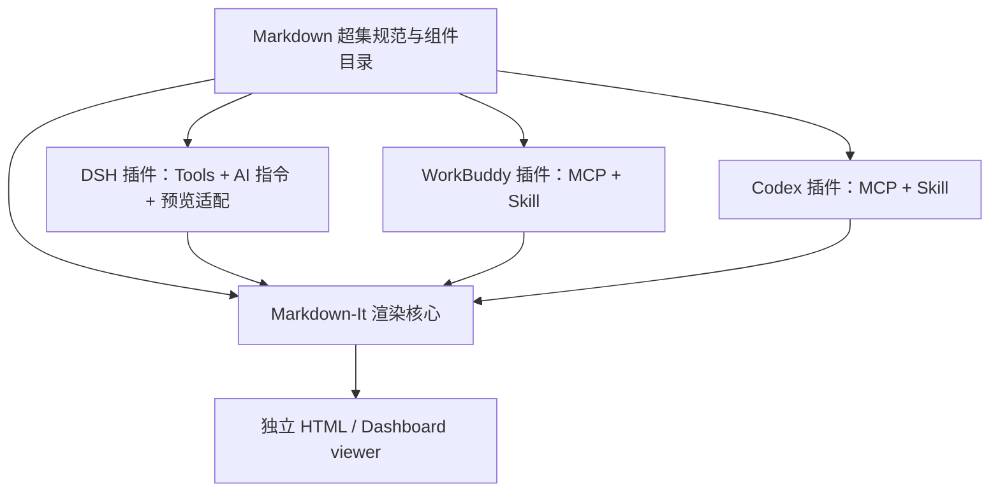

# Markdown 超集渲染器

**状态**：实现进行中；本文中的“当前实现”以仓库代码为准，尚未实现的扩展明确标为后续范围。
**回答的问题**：如何定义一个独立于宿主的 Markdown 超集，用 Markdown-It 将 AI 输出渲染为报告或 dashboard，并通过宿主插件让不同 AI 知道可用组件、按统一格式生成内容？

---

## 0. 架构原理（先看这一节）

**Markdown 超集是唯一内容格式，HTML 是它的展示产物。** AI 负责生成普通 Markdown 和受 schema 约束的声明式组件块；渲染器负责解析、校验和绘制。renderer 不执行 JavaScript、任意 HTML 或 SQL；DSH adapter 只按 frontmatter 中受限的 SQLite manifest 只读执行参数化查询，正文 SQL fence 始终只展示。

这是经典的「内容与展示分离」问题。把图表配置、Excalidraw 场景或大表格直接写进 HTML 字符串，会让 AI 输出难以校验、内容难以编辑、渲染难以升级。用 Markdown-It 的 token 和 renderer 扩展点识别少量声明式块，可以保留 Markdown 的可读性，并让各类可视化各自调用成熟运行时。

**这是一个新的、独立的 GitHub 项目。** 渲染器、格式规范、组件实现和各宿主插件都放在这个项目内。运行时不依赖 DSH 当前仓库的文件、`packages/ui`、内部 API 或未发布的包。DSH、WorkBuddy、Codex 插件只依赖本项目自身发布的格式/渲染包，以及各宿主公开的扩展 API。

这里有两类插件，必须分开：

1. **Markdown 渲染扩展**：实现 `mermaid`、图表、SQL、表格、分栏等组件；它们只认识本项目定义的 Markdown 超集。
2. **宿主适配插件**：分别面向 DSH、WorkBuddy、Codex。插件向宿主注册报告工具，并提供 Skill/Rule 等 AI 指令，告诉 AI 哪些组件可用、何时使用和如何生成。工具返回统一的 `ReportDocument` 或报告产物引用；宿主插件不重写渲染逻辑。



同一份文档可用线性报告模式或 dashboard 模式呈现。报告适合章节叙述和长文；dashboard 用声明式布局组合 KPI、图表、表格和说明卡片。数据集用 `dataRef` 引用，避免把大量行直接塞进 Markdown 正文。

## 1. 结论先说

1. **用 Markdown-It 做解析内核**，定义受约束的 Markdown 超集、组件 schema 和 HTML viewer；不允许任意 HTML/JS 扩展。
2. **新建独立 GitHub 项目**。项目内部用 workspace 管理格式规范、渲染核心、viewer、CLI 和宿主插件；不读取或导入当前 DSH 仓库文件。
3. **宿主插件按平台独立打包**：共享组件目录和报告工具语义；分别适配 DSH、WorkBuddy、Codex 的 tools、Skill/Rule、产物和预览能力。
4. **支持报告和静态 dashboard 两种呈现模式**。Dashboard 是该格式的布局/组件组合能力，不等于实时数据平台；V1 使用文档内的数据快照，后续再评估查询、刷新和跨图联动。
5. Mermaid、AntV Infographic 和 Excalidraw 使用各自官方开源 renderer；目录、图表、长表、T8 和 SQL 格式化也由开源库提供。SQL 默认折叠；长表封装为 Tabulator 数据表组件。

## 2. 项目边界与依赖原则

- 项目不拥有宿主或外部业务数据，不连接远程业务数据库；可通过宿主 adapter 只读加载 Markdown 声明的本地 SQLite sidecar，并将数据物化为静态快照。
- 宿主插件可以依赖本项目同一 GitHub 仓库中的 workspace 包，发布后通过固定版本消费；不得通过相对路径、submodule 或运行时文件引用依赖任何宿主的私有仓库。
- 每个宿主插件只依赖宿主公开的插件格式、MCP/Skill/Rule API 或公开 SDK。宿主缺少内嵌 viewer 能力时，使用 host-managed artifact/resource、本地 HTML 产物或纯 Markdown 回退，不让核心格式绑定单一宿主。
- 本项目内的视觉 Token、Tailwind 样式、组件基础和可访问性规则由 viewer 自己维护。宿主可提供展示容器，但不决定报告渲染样式。
- Markdown-It 的 renderer rule 和插件机制适合将 fenced block 转成自定义组件；渲染核心把所有组件统一注册到 registry，并执行 schema 校验。

## 3. 方案

### 3.1 用户流程

1. AI 通过宿主适配插件获取 Skill/Rule 指令和组件目录，知道 `md-report/1` 支持的语法、组件、字段限制和示例。
2. AI 直接生成 `ReportDocument`；需要校验、预览或导出时，调用该宿主插件注册的 `validate_report` / `render_report` 工具。工具接收 Markdown 超集文本和显式声明的数据、资源。
3. 工具调用本项目同一发布版本的 renderer，返回诊断信息以及宿主可消费的单文件 HTML artifact 或本地文件引用。宿主插件按自身 API 展示结果，不改变 Markdown 内容格式。
4. 不支持自定义 UI 的宿主仍可拿到纯 Markdown 回退和可下载的静态 HTML；核心渲染不依赖远程 CDN 或报告后端。

### 3.2 内容语法与块范围

**普通 Markdown 优先。** 标题、段落、引用、列表、代码、图片、链接和中小型表格使用标准 Markdown。报告图片使用 `` 引用 `ReportDocument.assets`；ID 使用 `[A-Za-z][A-Za-z0-9._-]{0,127}`，不接受任意远程图片 URL。不要为了视觉样式给普通段落新增专用语法。

| 块 | Markdown 入口 | 数据约定 | 目标呈现 |
| --- | --- | --- | --- |
| Dashboard 布局 | `:::: dashboard columns=12` + `::: panel span=...` | 面板内使用 Markdown 和受支持的组件块；数据仍通过 `dataRef` 引用 | 响应式网格，可组合 KPI、图表、表格和说明；静态快照，可在本地筛选/排序 |
| 指标摘要 | ```` ```kpi ```` | JSON：字面值，或 `dataRef` + `field` 引用单行 SQLite 摘要；可用 `changeField` / `periodField` 绑定变化值和周期 | 指标卡片，支持同比/环比和状态色；数据库更新后重新渲染会刷新绑定值 |
| 统计图 | ```` ```chart ```` | JSON：图类型、`dataRef`、x/y/series 字段、标题、单位 | ECharts 折线、柱状、面积、散点、饼图；支持 tooltip 和图例 |
| 大数据表 | ```` ```data-table ```` | JSON：`dataRef`、列配置、格式化、默认排序、可视区高度 | 固定高度的内部滚动区、固定表头、横向滚动；按需虚拟化行和宽表列；支持搜索/排序；中小表仍用 Markdown 表格 |
| SQL 展示 | ```` ```sql dialect=postgresql ```` | SQL 原文；方言由 fence 参数指定，默认标准 SQL | 用 `sql-formatter` 按方言格式化；默认折叠，显示方言和行数；格式化失败时保留原文；正文 SQL fence 不执行 |
| SQLite 数据源 | YAML frontmatter 的 `sqlite` | 一个工作区相对数据库路径；每个 dataRef/sceneRef 声明表名和 `.sql` 文件/短内联查询，或直接声明 SQLite view | DSH 在会话工作区内只读执行声明来源，物化一致快照后再验证和渲染；HTML 内嵌快照 |
| Mermaid | ```` ```mermaid ```` | Mermaid 官方 DSL | 由锁定版本的 Mermaid runtime 渲染完整图表语法；HTML 离线可用 |
| AntV Infographic | ```` ```infographic ```` | AntV Infographic DSL | AI 生成的信息图、步骤图和结构图 |
| AntV T8 | ```` ```antv-t8 ```` | T8 叙述文本语法 | 指标名称、数值、变化和判断嵌入分析文字 |
| Excalidraw | ```` ```excalidraw ```` | SQLite `sceneRef` 或官方场景 JSON | 调用官方 `@excalidraw/utils` 导出只读 SVG；场景数据与数据集可以存放在同一个 SQLite 文件中 |
| 提示框 | `::: note`、`::: warning`、`::: success` | Markdown-It container 内容 | 说明、风险、结论等提示块 |
| 内容分栏 | 相邻的 `[column ... ]` 块 | 每列内部是普通 Markdown | 桌面端并排显示；窄屏和打印时改为单列 |
| 可折叠详情 | `[details 摘要 ... ]` | 详情内部是普通 Markdown | 默认折叠；显式 `open` 才默认展开 |

示例：

````markdown
---
format: md-report/1
mode: report
title: 月度经营分析
---

## 核心指标

```kpi
{"items":[{"label":"营收","value":1280000,"unit":"元","change":0.12,"period":"环比"}]}
```

## 营收趋势

```chart
{"kind":"line","title":"月营收","dataRef":"monthly_revenue","x":"month","y":"revenue","unit":"元"}
```

```data-table
{"dataRef":"order_details","title":"订单明细","viewportHeight":560}
```

```sql dialect=postgresql
select region, sum(amount) as revenue
from orders
group by region
order by revenue desc;
```

[column
## 结论
华东区营收最高。
]
[column
## 风险
华南区退款率连续两月上升。
]


````

Dashboard 示例：

`````markdown
---
format: md-report/1
mode: dashboard
title: 月度经营
---

:::: dashboard columns=12
::: panel span=3
```kpi
{"items":[{"label":"营收","value":1280000,"unit":"元","change":0.12}]}
```
:::
::: panel span=9
```chart
{"kind":"line","title":"月营收","dataRef":"monthly_revenue","x":"month","y":"revenue"}
```
:::
::: panel span=12
```data-table
{"dataRef":"order_details","title":"订单明细","viewportHeight":480}
```
:::
::::
`````

Dashboard 也可以在 `mode: report` 文档中作为一个章节嵌入；它是展示布局，不是新的数据源或查询语言。

**报告数据合同：** `ReportDocument` 是包含 Markdown 正文和可选数据/资源映射的传输封套。格式版本和模式只在 Markdown frontmatter 中声明。图表和大表格只写 `dataRef`，正文不内嵌大批行数据；`dataRef` 只能引用封套或资源 manifest 中明确声明的数据集。图表和大表格不执行 SQL、远程查询或任意 URL 读取。列名、类型、单位、缺失值处理和数据更新时间属于数据集元信息，供展示和来源说明使用。

### 3.3 插件与开源项目选择

下表是 2026-10-16 的代码库与文档检索结果。Star 数只是维护风险线索，不是唯一选择标准。实现前还要核对版本、依赖、许可证、浏览器支持和实际 block 输出。

| 能力 | 检索结果 | 决策 |
| --- | --- | --- |
| Markdown 内核 | [`markdown-it`](https://github.com/markdown-it/markdown-it) 有 token、rule、renderer 扩展机制 | **采用**。以 Markdown-It `default` preset 为基础，在格式规范中逐项列出表格、删除线、任务列表等语法；不笼统宣称“完全兼容 GFM”。原始 HTML 默认关闭。 |
| Frontmatter | [`yaml`](https://github.com/eemeli/yaml) 是维护中的 YAML 解析/序列化库；Markdown-It front-matter 插件只负责提取，解析器仍由调用方提供 | **解析 Markdown-It 之前处理**。用受限分隔符提取首部 frontmatter，以 `yaml` 的受限 schema 解析并用 JSON Schema 校验；只把移除 frontmatter 后的正文交给 Markdown-It。禁止自定义 tag、alias 和重复键，不额外引入 front-matter Markdown-It 插件。 |
| 任务列表 | [`markdown-it-task-lists`](https://github.com/revin/markdown-it-task-lists) 为 Markdown-It 增加 GitHub 风格任务列表；默认复选框为 disabled | **可选纳入基础 Markdown 语法**。如果启用，只输出不可交互的只读状态，不允许报告直接修改任务状态。 |
| 锚点 / 目录 | [`markdown-it-anchor`](https://github.com/valeriangalliat/markdown-it-anchor) 为标题生成 id；[`markdown-it-toc-done-right`](https://github.com/nagaozen/markdown-it-toc-done-right) 生成语义化目录 | **采用这两个开源插件**。目录按 H2–H4 标题生成，目录链接和标题锚点使用同一套 slug 规则；报告至少有两个章节标题时自动显示目录。 |
| 提示框 | [`markdown-it-container`](https://github.com/markdown-it/markdown-it-container) 支持命名容器 | **采用**。只注册固定的 `note / warning / success` 类型，不从 Markdown 拼接任意 HTML 属性。 |
| 分栏 / 折叠详情 | [`@digitalocean/do-markdownit`](https://github.com/digitalocean/do-markdownit) 是 Apache-2.0 的 Markdown-It 插件，提供 `[column ... ]` 和 `[details ... ]` 语法。它也包含许多无关 embed，且默认会启用多个扩展。GitHub Advisory Database 记录了该包 `<=1.16.1` 的类型混淆问题，当前没有列出修复版本。 | **有条件复用**。实现前核对当前版本是否修复安全公告，并确认能只加载 `columns`、`details` 两项；如果不能证明安全隔离或关闭其他功能，就实现本项目的窄 Markdown-It 规则，不把整个插件作为运行时依赖。 |
| SQL 格式 | [`sql-formatter`](https://github.com/sql-formatter-org/sql-formatter) 是 MIT 的 JavaScript SQL 格式化库，支持 SQLite、DuckDB、PostgreSQL、MySQL、BigQuery 等方言。 | **采用 sql-formatter**。`sql` fence renderer 默认折叠并调用库格式化；格式化失败原样显示。正文 SQL fence 只展示；frontmatter 中 `sqlite.datasets` / `sqlite.scenes` 声明的只读查询由宿主执行。 |
| Mermaid | 官方 [`mermaid`](https://github.com/mermaid-js/mermaid) runtime 支持完整图表语法；离线包体积较大，渲染输出需启用 strict 安全级别。 | **采用官方 Mermaid runtime**。只在文档使用 Mermaid 时把锁定版本的运行时嵌入单文件 HTML，使用 `securityLevel: strict`，断网可渲染。 |
| Infographic | AntV 官方 [`@antv/infographic`](https://github.com/antvis/Infographic) 提供 DSL、主题和内置模板。 | **采用官方运行时和模板**。只在文档使用 Infographic 时嵌入库代码，并使用系统字体，避免报告从 CDN 请求字体。 |
| AntV T8 | [`@antv/t8`](https://github.com/antvis/T8) 是 MIT 的叙述文本可视化库，提供语法解析和实体类型 | **采用官方 `@antv/t8` runtime**。在 HTML 中仅当文档使用 T8 时嵌入官方运行时代码；分析文字由 T8 语法渲染，HTML 离线可用。 |
| Excalidraw | [`@excalidraw/utils`](https://github.com/excalidraw/excalidraw/blob/master/packages/utils/README.md) 的官方 `exportToSvg` 能保留 Excalidraw 场景样式；浏览器运行包过大，不适合塞进单文件 HTML。 | **采用官方 `exportToSvg` 在生成报告时导出 SVG**，把 SVG 内嵌到 HTML；HTML 不需 Excalidraw 编辑器或字体 CDN。 |
| 统计图 | Apache ECharts 采用 Apache-2.0 许可，提供交互式图表和独立浏览器运行时 | **采用 ECharts**。报告只暴露有限、安全的声明式图表 spec，不让 AI 输出 JavaScript；将运行时内嵌到导出 HTML。 |
| 大表格 | [`Tabulator`](https://github.com/tabulator-tables/tabulator) 提供表格布局、排序、虚拟行和横向/纵向滚动，MIT 许可 | **采用 Tabulator 并封装为 `data-table` Markdown 组件**。DSH adapter 可从同一 Markdown frontmatter 声明的 SQLite 文件物化数据快照；其他宿主也可传入已授权的 `ReportDocument.datasets`。renderer 不连接数据库。 |
| 分析公式 | [`KaTeX`](https://github.com/KaTeX/KaTeX) 可渲染统计公式；Markdown-It 有 KaTeX/TeX math 插件 | **列为 V1 可选能力**。报告启用公式时才引入；限制公式长度和宏扩展。 |
| 来源脚注 | [`markdown-it-footnote`](https://github.com/markdown-it/markdown-it-footnote) 支持文档脚注 | **列为 V1 可选能力**。用于指标口径、数据来源和方法说明；链接需遵守 URL 白名单规则。 |
| CSV 数据资源 | CSV 适合一次性导入或小型静态数据；本项目由 `@mdreport/data-sources` 提供 CSV parser。 | **提供 `parseCsvDataset` / `readCsvDataset` helper**，按列 schema 转成统一快照。它与 SQLite sidecar 是两种数据输入方式；不做通用数据清洗或 ETL。 |
| SQLite 数据源 | SQLite 是可嵌入、零配置的本地数据库；Node 22.13+ 提供内置 `node:sqlite`。 | DSH adapter 从 frontmatter 读取工作区相对路径、source table 和 queryFile/view/inline query 引用；通过 DSH filesystem service 校验路径，再用只读连接物化 datasets 和 Excalidraw 场景。HTML 是静态快照。 |
| 透视分析表 | AntV [`S2`](https://github.com/antvis/S2) 面向表格分析和交叉分析 | **P2 候选**。只有报告需要分组汇总、透视或单元格图表时才接入；普通明细表用 Tabulator。 |
| 地理图 | AntV [`L7`](https://github.com/antvis/L7) 面向地理空间可视化 | **P2 候选**。首批报告不强制地图；需要地图时先明确底图来源、许可、离线和坐标格式。 |

**插件接入规则：** 现成适配器优先，但适配器必须通过许可证、依赖体积、离线行为、XSS/SVG 安全、错误恢复和目标 Markdown-It 版本检查。任一关键项不通过，就复用底层官方库并在 `src/blocks/` 写一层窄适配器，不把低质量插件的约束扩散成产品契约。

**组件状态：** 当前实现包括基础 Markdown、由 `markdown-it-anchor` 与 `markdown-it-toc-done-right` 生成的报告目录、提示框、分栏/折叠详情、KPI、ECharts 图表、Tabulator 虚拟数据表、`sql-formatter` SQL 展示、CSV helper、SQLite frontmatter 查询、官方 Mermaid 图表、AntV Infographic DSL / 模板、官方 T8 叙述文本渲染，以及由 `@excalidraw/utils` 导出的 SQLite `sceneRef` 静态 SVG。除 `sqlite.datasets` / `sqlite.scenes` 声明的只读查询外，正文 SQL fence 不执行。公式、脚注、透视表、地图和可移植 `.mdreport` 包不属于当前实现范围。Infographic 使用系统字体；Excalidraw SVG 不内嵌外部字体。

### 3.4 技术边界

- **独立 GitHub 仓库**：项目内部可用 pnpm workspace，但每个发布包都只从该仓库源码构建。建议结构：

  ```text
  packages/
    spec/                 # 格式版本、组件目录、ReportDocument / manifest JSON Schema
      components/         # 组件语法、schema、示例和能力元数据的唯一来源
    renderer-core/        # Markdown-It、registry、安全校验
    viewer/               # 独立 HTML viewer、主题、布局和组件
    cli/                  # validate / render / export 命令
    host-sdk/             # 宿主无关的工具语义和适配接口
  plugins/
    components/           # Markdown-It block / inline render extensions
      mermaid/
      chart/
      table/
      sql/
      infographic/
      t8/
      excalidraw/
    hosts/                # independent host packages
      dsh/
      workbuddy/
      codex/
  examples/ docs/ tests/
  ```

- **格式合同**：Markdown frontmatter 是唯一元信息来源，且为必填：`format: md-report/1`、`mode: report|dashboard`、`title`。`title` 是 viewer 显示的页面标题；正文不要再重复同级 H1。`ReportDocument` 只是宿主工具的传输封套，包含 `markdown` 原文和可选的 `datasets` / `assets`；不再重复 frontmatter 字段。frontmatter 使用受限 YAML 子集并禁用自定义 tag、alias 和重复键。V1 的组件版本由 `format` 版本及 renderer registry 共同约束；每种 fenced block 按自己的 schema 校验，不额外要求 Markdown 中重复 `type + version` 字段。
- **数据与资源封套**：`ReportDocument.datasets`、`.scenes` 和 `.assets` 是以稳定 ID 为键的快照映射。Markdown frontmatter 可以明确声明一个 `sqlite.path` 和多个 datasets/scenes 来源；路径只能是会话工作区内的相对 `.db` / `.sqlite` / `.sqlite3` 文件，不能使用绝对路径或 `..`。SQL 查询来源声明 `table` / `tables` 并在 `.sql` `queryFile` 或短内联 `query` 中二选一；数据库 view 来源声明 `view` 名称。每个来源可选绑定参数；数据库只读打开，数据库和 SQL 文件路径由 DSH filesystem service 校验。所有查询在同一个只读事务中物化，再交给 renderer；浏览器不连接数据库。Excalidraw 场景 JSON 和数据集可放在同一 SQLite 文件中，正文分别用 `sceneRef` / `dataRef` 引用。图片不是 SQLite blob：frontmatter `assets` 显式列出工作区相对图片路径和 MIME 类型，DSH 校验并读取后转换为 `ReportDocument.assets`。
- **源文件与可移植性**：一个报告的源由 Markdown、其显式声明的 SQLite 数据库、引用的 `.sql` 文件和可选图片文件组成；这些文件应保存在同一工作区并通过相对路径声明。DSH 成功渲染时将输入 Markdown 保存为会话工作区中的独立源文件并返回路径；工具参数中的 inline datasets/assets 不进入 Markdown，DSH 会发出可移植性 warning，应只用于一次性报告。当前不实现 `.mdreport` ZIP 包；分享时需要同时保留 Markdown、SQLite 文件、queryFile 文件和所引用图片。超出 HTML 预算时提示拆分数据或报告。
- **大数据和文件传输**：大行数据保存在 SQLite，不进入模型上下文或工具参数；Markdown 携带相对数据库路径、source table 和 queryFile/view/inline query 引用及绑定参数。当前每个查询最多物化 5,000 行，每份 report 的 renderer snapshot 上限为 1 MB，单文件 HTML 上限为 12 MB。超过限制时明确报错，后续再评估分页或外部 viewer。
- **组件目录与 AI 指令**：当前共享的 AI 指令来源是 `.agents/skills/md-report/SKILL.md`，DSH 构建时复制该文件；renderer-core 中的校验逻辑是可执行组件 schema。由机器可读组件目录生成 schema、文档和 Skill/Rule 的流程尚未实现，列为后续工程工作，不视为现有能力。
- **宿主工具合同**：统一语义而不强制统一平台协议。V1 定义 `validate_report(document)` 和 `render_report(document)`：前者返回带 Markdown 行号/组件路径的诊断；后者校验并生成预览资源或静态 HTML 产物。宿主工具接收/返回的正文必须是 `ReportDocument.markdown`；渲染 HTML 是预览产物，不替代 Markdown 源文。每个平台插件负责把这两个语义映射到宿主的 tool、MCP、artifact 或 UI resource。工具不替 AI 推断业务口径或擅自发起查询；DSH 只执行文档声明且经路径、只读和行数约束检查的 SQLite 查询。
- **宿主插件职责**：每个 `plugins/hosts/{dsh,workbuddy,codex}` 包含宿主 manifest、工具注册/协议适配、生成的 AI 指令、预览/产物回传适配和兼容性检查。Codex 可采用 Skill + MCP；WorkBuddy 可采用 MCP + Skill；DSH 适配器依赖稳定、明确的 DSH extension contract。只能依赖宿主公开接口；宿主支持 artifact/resource 时返回 host-managed HTML artifact/resource，否则返回本地 HTML 产物。DSH 成功渲染时还会把输入 Markdown 保存到会话工作区并返回源文件路径；SQLite 和图片继续保留在 frontmatter 声明的相对路径。V1 不承诺项目自建 viewer URL，因为项目不部署报告托管服务。
- **工具运行方式**：默认交付浏览器 renderer、CLI 和无状态工具实现，不部署产品数据库或 SaaS。宿主支持本地运行时就用本地 MCP stdio；WorkBuddy 也可选 CLI + Skill，但同一个连接器不能混用 MCP 和 CLI。需要 Web 端或远程工具时才部署无状态 HTTPS MCP endpoint。Codex 的本地 MCP 可能被标为 Desktop-only，公开发布还可能需要准入；需按分发目标选择。
- **不依赖当前项目文件**：不得导入当前 DSH monorepo 的组件、主题、路径别名、内部 API、脚本、配置或本地包。DSH 适配器可以依赖 DSH 的公开插件 SDK/extension contract；这属于宿主集成接口，不是对当前 GitHub 仓库文件的依赖。
- **渲染核心**：Markdown-It 实例集中创建，扩展注册到 registry。fenced block 接收解析后的 token 和受校验数据，不拼任意脚本字符串。扩展可单独按需加载，单个块的错误不阻断其他报告内容。V1 只在完整 `ReportDocument` 到达后校验、渲染和导出，不提供流式预览。
- **资源图片规则**：`asset:` 只用于图片 token，renderer 单独校验 asset ID 并映射到 `ReportDocument.assets`；不能把 `asset:` 加为全局链接协议，也不允许 Markdown 读取任意文件路径或远程图片 URL。DSH 可从 frontmatter 的 `assets` manifest 按工作区相对路径加载已声明的 PNG/JPEG/WebP/GIF 文件；其他宿主可以传递同样形状的资源 bytes。导出 HTML 内嵌图片后可离线查看。
- **Dashboard**：`mode: dashboard` 必须包含一个顶层 `:::: dashboard`；`mode: report` 可在章节中嵌入 dashboard。使用受限的 `::: panel span=N` 声明式网格，网格固定 12 列，`span` 为 1–12 的整数；panel 不嵌套。宽屏按 span 显示最多 4 列，平板采用 2 列布局，窄屏和打印堆叠为 1 列。Markdown-It container 需要外层使用更多冒号，避免和内层 panel 的结束标记冲突。面板允许放入 Markdown、KPI、图表和数据表；不能放任意 HTML/CSS/JS。V1 输出静态快照，可在本地执行表格搜索/排序和图表图例操作；跨图联动、自动刷新和服务端查询列为后续能力。
- **SQL 块**：正文 SQL fence 调用 `sql-formatter` 并默认折叠；不实现自制 SQL token 高亮，格式化失败保留原文。正文 fence 仅展示；frontmatter SQLite source 查询单独由宿主只读执行。
- **分栏和详情**：只用于短内容对照和附录，不用于长篇正文。桌面端并排，窄屏和打印堆叠。详情默认关闭，只有显式 `open` 才默认展开。
- **静态数据**：`dataRef` / `sceneRef` 只引用文档中 SQLite manifest 声明且宿主已经物化的数据或场景。renderer 不调用业务 API、不查询数据库、不从 CDN 拉运行时；Markdown 声明的数据库路径必须被宿主限制在会话工作区内。
- **单文件 HTML**：导出自包含 `.html`；CSS、所需 JavaScript 运行时、datasets、静态 SVG 和图片资源内嵌，不通过相对路径或 CDN 加载。用户双击打开后可离线查看。超过单文件上限时明确报错；当前不提供 `.mdreport` 包作为回退。HTML 中的折叠只影响展示，不保护数据；接收者可以检查并提取内嵌数据。
- **长表格**：使用固定高度内部滚动、粘性表头、行虚拟化；宽表按需列虚拟化。过滤和排序作用于当前文档包含的全量数据。虚拟化只减少 DOM，不降低内存；超出静态包预算时由工具提示拆分/分页，不承诺实时服务端表格。
- **安全与可访问性**：原始 HTML 默认关闭；Mermaid 配置 `securityLevel: strict`；各可视化运行时使用固定锁定版本和 CSP 哈希，不从 CDN 加载。Excalidraw scene 通过官方 SVG exporter 生成静态图形，不把编辑器运行时或 scene JSON 放入 HTML。拒绝 Markdown 原始脚本和 `javascript:` 链接；Markdown 图片只接受已声明的 `asset:` ID；DSH 只读取工作区内受限数量和体积的相对图片文件，不读取远程图片或任意路径。外部链接由用户主动点击，链接协议限制为 `https:`、`http:`、`mailto:` 或文档内锚点。图表提供标题、可访问名称和文字摘要；数据表支持键盘浏览；颜色不能作为唯一的信息区分方式。
- **样式**：独立 viewer 自己维护主题 Token、Tailwind CSS 和交互组件，不从任何宿主仓库导入视觉文件。宿主只决定 viewer 的打开方式和外层容器样式。
- **Excalidraw**：Markdown 通过 `sceneRef` 从同一个 SQLite 文件读取官方 scene JSON；生成时调用官方 `exportToSvg` 输出静态 SVG，不提供画布编辑、多人协作或场景回写。

### 3.5 取舍：为什么不选另外那条路

| 方案 | 好处 | 代价 | 结论 |
| --- | --- | --- | --- |
| 只用标准 Markdown | 通用、易生成、易迁移 | 难以表达 dashboard 布局、SQL 折叠、长表和复杂图表 | 作为基础语法，不作为完整报告格式 |
| 直接让 AI 输出 HTML/JS | 表达自由 | XSS 风险高、结果难校验、主题和运行时不稳定 | 不采用 |
| 为每个宿主分别发明一套 Markdown | 可适配宿主习惯 | DSH、WorkBuddy、Codex 之间无法迁移，能力文档会漂移 | 不采用；共享格式版本和组件目录 |
| 把 renderer 放进 DSH 插件或依赖 DSH 源码 | 初期接入路径短 | 项目不能独立构建，其他宿主被迫依赖 DSH | 不采用 |
| 所有宿主共用同一个插件包 | 发布物少 | 各宿主的 MCP、Skill、manifest、预览和 artifact API 不同 | 不采用；共享核心，分别适配 |
| 独立 Markdown 超集 + renderer 扩展 + 宿主适配插件 | 格式可移植，核心可离线运行，宿主可独立演进 | 需要维护格式版本和多个薄适配器 | **采用** |
| 把 dashboard 做成实时 BI 平台 | 能连接实时数据源和权限系统 | 超出 Markdown 渲染器范围，需要后端、查询和权限模型 | 不纳入 V1；先渲染文档内数据快照 |

## 4. 项目结构与交付面

本 PRD 的目标是新建一个独立 GitHub 仓库。当前 DSH 仓库只保存这份规划文档；产品实现不修改或引用当前仓库文件。

- 新仓库规划包含 Markdown 超集规范、组件目录、渲染核心、独立 viewer、CLI、示例和 DSH / WorkBuddy / Codex 三个宿主插件；V1 先发布一个经过验证的参考 adapter。
- 所有组件语法、schema 和版本由新仓库维护；宿主适配器只消费公开发布的本项目包，以及各宿主自己的公开扩展 API。
- AI 指令从组件目录生成或校验。Skill/Rule 中包含组件选择指南和可复制的 Markdown 示例；MCP/tool schema 提供渲染与校验能力。
- 当前 V1 范围：格式规范、纯 Markdown + 声明式块、`report` / `dashboard` 两种模式、Markdown + SQLite sidecar 源文件、完全自包含的单文件 HTML 导出、`validate_report` / `render_report` 工具语义和一个经过验证的参考宿主适配器。`.mdreport` ZIP、CLI 和更多宿主 adapter 是后续范围。
- V1 不要求独立 SaaS、用户账号、报告云存储、数据库服务或服务端渲染。

## 5. 风险与验收

| 风险 | 验收方式 / 通过条件 |
| --- | --- |
| 各宿主对 tools、Skill/Rule 和 UI resource 的支持不同 | 每个已发布宿主 adapter 提供能力矩阵和独立适配检查；没有内嵌 viewer 的宿主能回退到 HTML artifact/resource 或本地文件 |
| 报告资源过大或宿主工具有输入大小限制 | 大数据可保存在 Markdown 声明的工作区 SQLite sidecar，不进入模型上下文或工具 JSON 参数；每个查询最多 5,000 行、物化数据集最多 1 MB、单文件 HTML 最多 12 MB；超限时给出可操作诊断 |
| 组件语法和 AI 指令版本漂移 | 当前共享 Skill 位于 `.agents/skills/md-report/SKILL.md`，运行时 schema 在 renderer-core 校验；后续自动生成流程尚未实现；未知组件给出明确诊断和原文回退 |
| AI 生成的 block JSON 错误或 dataRef 缺失 | 合法/非法样例覆盖；诊断带行号和组件路径；某个块错误不影响其他章节 |
| Markdown、图表、Infographic、Excalidraw 输出脚本或危险 SVG | 测试脚本、事件属性、危险 URL、异常 SVG；危险内容不执行，原始 HTML 默认关闭 |
| Mermaid 社区适配器带来不安全默认值 | 验证 strict 安全级别、禁用远程 icon pack 和可执行点击；不满足时改用官方库和本项目 fence renderer |
| 大数据表格滚动卡顿 | 当前查询最多 5,000 行、report snapshots 最多 1 MB；在这一范围内检查虚拟滚动期间 DOM 节点和两轴滚动；50,000 行性能目标延后到支持分页或更大预算之后 |
| SQL 格式化意外改变语义或 SQL 默认展开 | 使用 `sql-formatter`；检查默认 HTML 不含 `open` 属性；覆盖支持的方言；格式化异常时原样回退；正文 SQL fence 不执行，frontmatter 查询仅由 host SQLite loader 只读执行 |
| Dashboard 被误解为实时 dashboard | 文档、UI 和 tool 描述明确显示数据时间/快照状态；V1 只支持报告包内的数据和本地交互，不显示“实时”状态 |
| 报告、dashboard 在窄屏或打印中错位 | 2/3/4 列布局、窄屏和打印预览通过；窄屏与打印下 dashboard 按单列堆叠 |
| 依赖导致首屏或离线产物过大 | block renderer 按需加载；构建物断网可打开；按报告内容只打包实际使用的块资源 |
| 单文件 HTML 在浏览器本地打开时缺少模块、字体或 worker | 在支持的浏览器中以 `file://` 打开并断网检查；所有运行时和资源已内嵌；无法自包含的扩展不得进入首发 |
| 导出文件包含报告数据和折叠内容 | 文档与导出说明明确：HTML 中的 dataset、SQL 和资源可被查看/提取；导出包只包含本报告所需资源，不提供数据权限控制 |
| 静态报告资源路径不安全 | 拒绝路径穿越、未声明 dataRef 和默认远程依赖；外链只在用户点击后访问 |

## 6. 非目标

- 不做 Markdown 编辑器、通用 AI 对话产品、报告协作或云端报告管理。
- 不做数据仓库、ETL、Notebook、远程数据库连接或权限系统；只支持宿主在受限路径内只读加载文档声明的本地 SQLite sidecar。
- 不做图床或报告云托管；源文件由 Markdown、SQLite sidecar 和可选图片资源组成，发布 HTML 时内嵌所需数据和资源。
- 不执行 AI 生成的 JavaScript、任意 HTML 组件或正文 SQL fence；仅执行经宿主路径校验的 SQLite frontmatter 查询、引用的受限 `.sql` 文件或 SQLite view。
- 不把 V1 dashboard 承诺为实时 BI 产品；自动刷新、服务端查询、权限控制和跨图联动留待后续独立评估。
- V1 不做 Excalidraw 在线编辑、多人协作和场景回写。
- V1 不做任意第三方 renderer 插件市场；组件必须通过本项目 schema、安全和兼容性审核。
- 不依赖当前 DSH 项目中的文件、私有包、内部组件、主题或构建脚本。

## 7. 拆分后的工作包

1. **格式规范**：frontmatter、`ReportDocument` 数据/资源封套、Markdown 超集语法、组件 JSON Schema、版本策略和兼容性诊断。
2. **渲染核心与 viewer**：Markdown-It registry、安全策略、主题、HTML 静态导出、报告目录和打印适配。
3. **数据组件**：KPI、ECharts 图表、Tabulator 虚拟表格、默认折叠 SQL 和 Dashboard 网格；`@mdreport/data-sources` 将 CSV/SQLite 转为统一快照。
4. **可视化扩展**：已接入官方 Mermaid、AntV Infographic、AntV T8 和 `@excalidraw/utils`；Mermaid / Infographic 按需嵌入离线运行时，Excalidraw 在生成期间导出为静态 SVG。
5. **AI 组件目录**：已交付通用 `.agents/skills/md-report/SKILL.md`，由 DSH 构建时复制到插件包；集中 schema/说明生成器尚未实现，避免把它误写成现有能力。
6. **宿主适配器**：当前已实现 DSH tools、通用 Skill 注册、HTML attachment/workspace preview 和客户端渲染；WorkBuddy、Codex adapter 仍待实现，不能让一个宿主包成为其他宿主的构建依赖。

建议先交付格式规范、renderer、standalone viewer 和一个参考宿主；通过核心格式稳定性检查后，再并行接入另外两个宿主。宿主适配器不得阻塞核心包发布。

## 8. 未决问题

- [ ] 新仓库和 npm scope 的最终名称。PRD 暂用“Markdown 超集渲染器”作为产品名。
- [ ] 初始分发优先本地插件还是远程 MCP；当前已有 DSH 本地参考 adapter。Web 端 MCP 服务、CLI 和 Codex/WorkBuddy 分发仍需各自评估。
- [x] 首个参考宿主选 DSH；当前 adapter 编译并使用公开的 DSH tool、skill、attachment、Cordis 和 client UI contracts。
- [x] DSH 已提供当前使用的公开 extension contract（`@deepseek-ai/dsh-*` `0.2.1-alpha.5`）；后续升级仍需重新验证兼容性。
- [x] 当前输入预算：Markdown 1 MB、SQLite 每查询最多 5,000 行、renderer dataset snapshot 1 MB、所有报告图片 8 MB、单文件 HTML 12 MB；Markdown 小表切换阈值不固定，由内容规模和可读性决定。
- [ ] Dashboard V1 是否要支持多个图表共享本地筛选器。建议先完成静态布局、表格本地搜索/排序和单图交互；跨图联动列为 P2。
- [ ] `.mdreport` 可移植包是否进入后续版本；当前源文件合同是 Markdown + 相对路径 SQLite sidecar，且单文件 HTML 仍受 1 MB snapshot / 12 MB 导出限制。

## 9. 参考资料

- [Markdown-It renderer rules](https://github.com/markdown-it/markdown-it/blob/master/docs/examples/renderer_rules.md)
- [Markdown-It container nested delimiter guidance](https://github.com/markdown-it/markdown-it-container/issues/5)
- [do-markdownit columns/details syntax](https://github.com/digitalocean/do-markdownit#columns)
- [GitHub Advisory Database: do-markdownit type confusion](https://github.com/advisories/GHSA-2h8j-8r9p-849f)
- [eemeli/yaml](https://github.com/eemeli/yaml)
- [markdown-it-task-lists](https://github.com/revin/markdown-it-task-lists)
- [Excalidraw export utilities](https://github.com/excalidraw/excalidraw/blob/master/packages/utils/README.md)
- [Excalidraw self-hosted fonts](https://github.com/excalidraw/excalidraw/blob/master/packages/excalidraw/README.md#self-hosting-fonts)
- [Codex plugin architecture](https://developers.openai.com/plugins/concepts/plugins)
- [Codex desktop-only plugins](https://developers.openai.com/plugins/deploy/desktop-only)
- [WorkBuddy connector docs](https://www.workbuddy.cn/docs/connector)
- [WorkBuddy plugin docs](https://www.workbuddy.cn/docs/workbuddy/Plugins)
- [PRD 中涉及的开源渲染器和组件链接见 §3.3](#33-插件与开源项目选择)
