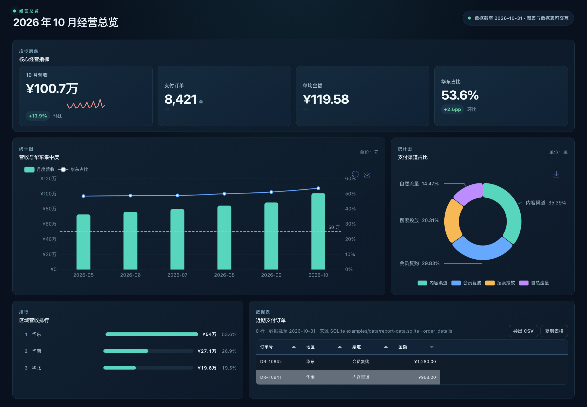
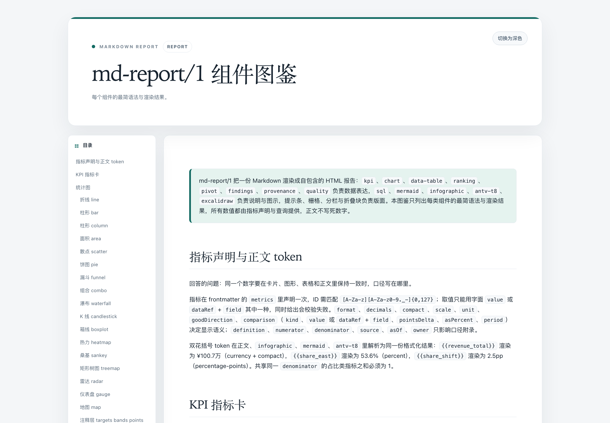

# drender

**让 Agent 生成口径一致、可校验、可交付的标准化数据报告。**

drender 为 Agent 定义 `md-report/1` 报告格式和渲染工具：Agent 用一份 Markdown 源文件组织指标定义、数据来源、图表和正文，渲染器再生成可交互、可离线打开的 HTML。

[查看组件图鉴 HTML](examples/template-gallery.html) · [查看经营仪表盘 HTML](examples/dashboard.html) · [查看 npm 插件](https://www.npmjs.com/package/@nonefire/dsh-drender-plugin)

## 要解决的问题

让 Agent 生成一份可信的数据报告，难点不只是写摘要和画图：

- 同一个指标会出现在 KPI 卡片、图表和正文中，数字、格式和统计口径容易不一致。
- 数据来源、查询口径、更新时间与结论分散，读者难以复核，也不容易按同样的数据重新生成。
- 单靠 Markdown 难以提供完整的交互图表和可交付页面，通常还要手工补图、排版和导出。

## drender 如何解决

`md-report/1` 把报告变成一份结构明确的 Markdown 源文件：指标只声明一次，组件通过指标和数据集引用取值，数据源、说明与版式也都有明确字段。

1. Agent 按 `md-report/1` 编写报告，并从 `drender-report` Skill 获取组件语法和报告规划指导。
2. `drender_validate` 检查格式、必填字段、数据和指标引用、布局结构及安全链接，在渲染前指出问题。
3. `drender_render` 在宿主侧只读加载声明的 SQLite 或 CSV 数据，将查询结果固化为快照，并渲染为自包含 HTML。

在 DSH 中，插件注册这两个工具和 `drender-report` Skill。一个指标只声明一次，卡片、图表和正文引用同一指标时会使用相同的值与格式。最终交付包括可编辑、可复现的 Markdown 源文件和无需 CDN 或数据库连接即可打开的交互式 HTML。

```text
SQLite / CSV + md-report/1 Markdown
                  ↓
       drender_validate → drender_render
                  ↓
        可复核源文件 + 离线 HTML 报告
```

## 实际效果

下面是仓库中的确定性示例数据渲染结果。HTML 报告内含图表运行时和数据快照，下载后可直接用浏览器打开。

### 经营仪表盘

[打开仪表盘 HTML 文件](examples/dashboard.html)



### 组件图鉴

组件图鉴覆盖指标声明与 token、KPI、统计图、排行榜、透视表、数据表、发现摘要、数据口径、数据质量、SQL、流程图、信息图、叙述文本、关系图，以及栅格、并排分栏和折叠详情。

[打开组件图鉴 HTML 文件](examples/template-gallery.html) · [查看图鉴 Markdown 源文件](examples/template-gallery.md)



> GitHub 仓库页会显示 HTML 文件内容；下载 HTML 后在浏览器中打开即可查看交互效果。当前仓库未启用 GitHub Pages，因此这里提供的是 HTML 文件链接和页面截图。

## 支持的报告组件

- **数据表达：** KPI、指标 token、折线、柱形、面积、散点、饼图、漏斗、组合、瀑布、K 线、箱线、热力、桑基、树图、雷达、仪表、地图、排行榜、透视表、数据表、发现摘要、指标口径和数据质量。
- **说明与图示：** SQL 代码块、Mermaid、AntV Infographic、AntV T8 叙述和 Excalidraw 场景。
- **页面布局：** 自动目录、提示条、折叠详情、2–6 列正文分栏，以及仪表盘 12 列面板栅格。图表可以在分栏中并排显示。
- **便携交付：** HTML 内嵌样式、所需运行时、数据快照和声明的图片，可离线查看。

## 安装 DSH 插件

```sh
dsh plugin --profile web add @nonefire/dsh-drender-plugin
```

插件会安装所需的第三方运行时依赖，并注册以下工具：

- `drender_validate`：校验 `md-report/1` 文档和数据、组件、布局引用。
- `drender_render`：生成自包含 HTML，保存 Markdown 源文件，并在宿主支持时提供侧栏预览和可下载附件。

需要 Node.js 22.13+，以及 DSH 的公开 tools、skill、filesystem 和客户端 UI 服务。通用 Skill 源文件位于 [`.agents/skills/drender-report/SKILL.md`](.agents/skills/drender-report/SKILL.md)。

## 最小示例

````markdown
---
format: md-report/1
mode: report
title: 月度经营报告
sqlite:
  path: data/monthly-review.sqlite
  datasets:
    monthly_total:
      table: monthly_revenue
      queryFile: queries/monthly-total.sql
    summary:
      table: regional_revenue
      queryFile: queries/october-summary.sql
metrics:
  revenue_total:
    label: 月营收
    dataRef: summary
    field: revenue_total
    format: currency
    currency: CNY
---

## 营收走势

本月营收为 {{revenue_total}}。

```chart
{"kind":"line","title":"月营收走势","dataRef":"monthly_total","x":"month","y":"revenue","unit":"元"}
```
````

在报告中，指标 token 从 `summary` 的单行聚合结果取值，图表从按月份聚合的 `monthly_total` 取数。声明的数据集、指标和图表字段必须与数据库及查询结果对应；`drender_validate` 会在渲染前检查这些引用。

## 构建与渲染示例

需要 Node.js 22.13+ 和 pnpm 11+。

```sh
pnpm install
pnpm build
node examples/render-examples.mjs
```

脚本会重建确定性的 SQLite 示例数据，并渲染仪表盘、分析报告、大型数据表和组件图鉴。SQLite 示例中的查询围栏会以只读方式执行；查询失败或无结果时脚本会报错。

其他示例：

```sh
node examples/compare-csv-sqlite-sources.mjs
node examples/sync-stock-example.mjs --offline
```

股票示例默认使用本地 SQLite 缓存；联网更新需要 EODHD API token。演示行情不是实时数据或投资建议。

## 数据与安全

可在 Markdown frontmatter 中声明一个工作区相对路径的 SQLite 文件，再为数据集指定查询文件、SQLite view 或简短内联查询：

```yaml
sqlite:
  path: data/monthly-review.sqlite
  datasets:
    monthly_revenue:
      table: monthly_revenue
      queryFile: queries/monthly-revenue.sql
```

插件在宿主侧以只读方式查询 CSV 或 SQLite，并将结果物化为 HTML 中的数据快照；浏览器不会直接访问数据库。每份报告的数据快照总量上限为 1 MB，每个数据集最多 5,000 行，SQL 文件最多 100 KB。图片必须在 frontmatter 中声明，且路径必须位于当前工作区。

渲染器拒绝原始 HTML 和不安全链接，不执行 Markdown 正文中的 SQL，也不运行用户提供的 JavaScript。导出的 HTML 包含数据快照，接收者可以检查其中的数据，请勿放入秘密或凭据。

## npm 包

面向 DSH 用户只发布和维护 `@nonefire/dsh-drender-plugin`。根目录以及 `renderer-core`、`data-sources`、`viewer-theme` 是内部构建模块，不单独发布；插件包内含渲染器、数据源、主题和 Skill。

## 许可证

MIT，见 [LICENSE](LICENSE)。
