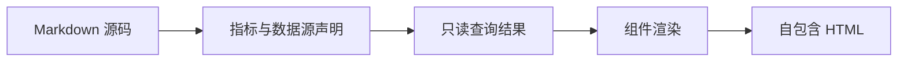

::: note
md-report/1 把一份 Markdown 渲染成自包含的 HTML 报告：`kpi`、`chart`、`data-table`、`ranking`、`pivot`、`findings`、`provenance`、`quality` 负责数据表达，`sql`、`mermaid`、`infographic`、`antv-t8`、`excalidraw` 负责说明与图示，提示条、栅格、分栏与折叠块负责版面。本图鉴只列出每类组件的最简语法与渲染结果，所有数值都由指标声明与查询提供，正文不写死数字。
:::

## 指标声明与正文 token

回答的问题：同一个数字要在卡片、图形、表格和正文里保持一致时，口径写在哪里。

指标在 frontmatter 的 `metrics` 里声明一次，ID 需匹配 `[A-Za-z][A-Za-z0-9._-]{0,127}`；取值只能用字面 `value` 或 `dataRef` + `field` 其中一种，同时给出会校验失败。`format`、`decimals`、`compact`、`scale`、`unit`、`goodDirection`、`comparison`（`kind`、`value` 或 `dataRef` + `field`、`pointsDelta`、`asPercent`、`period`）决定显示语义；`definition`、`numerator`、`denominator`、`source`、`asOf`、`owner` 只影响口径附录。

双花括号 token 在正文、`infographic`、`mermaid`、`antv-t8` 里解析为同一份格式化结果：`{{revenue_total}}` 渲染为 {{revenue_total}}（currency + compact），`{{share_east}}` 渲染为 {{share_east}}（percent），`{{share_shift}}` 渲染为 {{share_shift}}（percentage-points）。共享同一 `denominator` 的占比类指标之和必须为 1。

## KPI 指标卡

回答的问题：几个关键单值如何一眼看完，并带上单位与环比。

最小语法是一个 JSON 对象，`items` 1–12 条：

```kpi
{"title":"关键指标","kicker":"指标摘要","items":[
{"metricRef":"revenue_total","sparkline":{"dataRef":"monthly_total","x":"month","y":"revenue","title":"月度营收趋势"}},
{"label":"10 月营收（dataRef + field + changeField）","dataRef":"summary","field":"revenue_total","format":"currency","compact":true,"changeField":"revenue_mom","changeFormat":"percent","period":"环比"},
{"metricRef":"paid_orders"},
{"metricRef":"share_east"},
{"metricRef":"concentration"},
{"label":"单均金额（decimals 覆盖）","dataRef":"summary","field":"average_order_value","format":"currency","currency":"CNY","decimals":2}]}
```

item 的取值三选一：`metricRef`，或字面 `value`，或 `dataRef` + `field`；用 `metricRef` 时不能再写 `value`、`dataRef`、`field`、`changeField`。`change` + `period` 是字面写法，`changeField` + `periodField` 从数据列取环比与周期，两者不可同时出现。`direction` 可覆盖配色方向，`sparkline` 追加迷你趋势，`anchor` 生成页内锚点。本图鉴不使用字面 `value`，以免把数字写进正文。

## 统计图

回答的问题：数值随维度如何变化、如何构成。

`kind` 决定图形与必需字段；全部图形都用 `dataRef` 取数，并可选 `title`、`kicker`、`unit`、`anchor`、`metricRef`、`axisFormat`（`format`、`decimals`、`compact`、`currency`、`scale`）。折线、柱形、面积、散点、饼图与组合图要求每个 x（或 x + series）只有一行数据，重复坐标会在校验阶段报错，需要在查询里先聚合。

### 折线 line

回答的问题：一条或多条序列随时间的走向。`x`、`y` 必填，`series` 可选；本图同时演示 `anchor`。

```chart
{"kind":"line","title":"月营收走势（按区域）","dataRef":"monthly_by_region","x":"month","y":"revenue","series":"region","unit":"元","anchor":"revenue-trend"}
```

### 柱形 bar

回答的问题：分类之间的横向对比。

```chart
{"kind":"bar","title":"月营收对比","dataRef":"monthly_total","x":"month","y":"revenue","unit":"元"}
```

### 柱形 column

回答的问题：分类之间的纵向对比；`y` 可以由 `metricRef` 提供，此时不要再写 `y` 或 `unit`。

```chart
{"kind":"column","title":"区域营收对比","dataRef":"regional_revenue","x":"region","metricRef":"region_revenue"}
```

### 面积 area

回答的问题：走势的量级与累积感。

```chart
{"kind":"area","title":"营收走势","dataRef":"monthly_total","x":"month","y":"revenue","unit":"元"}
```

### 散点 scatter

回答的问题：两个数值字段之间是否存在相关。当 x 也是数值列时按数值轴绘制。

```chart
{"kind":"scatter","title":"订单数与营收","dataRef":"regional_revenue","x":"orders","y":"revenue","unit":"元"}
```

### 饼图 pie

回答的问题：构成占比。

```chart
{"kind":"pie","title":"渠道订单构成","kicker":"构成","dataRef":"channel_mix","x":"channel","y":"orders","unit":"单"}
```

### 漏斗 funnel

回答的问题：有序阶段的逐级留存。`sort: "none"` 保持查询返回的阶段顺序，默认按数值降序。

```chart
{"kind":"funnel","title":"转化阶段","dataRef":"conversion_steps","x":"stage","y":"users","sort":"none","unit":"人"}
```

### 组合 combo

回答的问题：同一 x 上量级不同的指标如何并置。`series` 1–6 条，`axis` 为 0 或 1 决定左右轴，条目字段为 `field`、`type`、`axis`、`name`、`stack`、`format`、`decimals`、`compact`；每个 x 只能有一行。

```chart
{"kind":"combo","title":"营收与华东集中度","dataRef":"monthly_share","x":"month","unit":"元","axisFormat":{"format":"currency","compact":true},"series":[{"field":"revenue","type":"bar","axis":0,"name":"月度营收"},{"field":"share_east","type":"line","axis":1,"name":"华东占比","format":"percent"}]}
```

### 瀑布 waterfall

回答的问题：期初到期末的增量从哪里来。`totalField` 为真值的行画成绝对值柱，其余行画增减。

```chart
{"kind":"waterfall","title":"营收桥","dataRef":"revenue_bridge","x":"item","y":"delta","totalField":"is_total","unit":"元"}
```

### K 线 candlestick

回答的问题：开、高、低、收与成交量的分布。`volume` 可选，给出后会附加副轴与缩放条。

```chart
{"kind":"candlestick","title":"价格走势","dataRef":"price_bars","x":"trade_date","open":"open","high":"high","low":"low","close":"close","volume":"volume"}
```

### 箱线 boxplot

回答的问题：分组数据的分布与离群情况；分位数由渲染端计算，查询给出原始行即可。

```chart
{"kind":"boxplot","title":"品类金额分布","dataRef":"category_distribution","x":"category","y":"amount","unit":"元"}
```

### 热力 heatmap

回答的问题：两个分类维度的交叉强度。`x`、`y` 是分类轴，`value` 是强度。

```chart
{"kind":"heatmap","title":"区域与月份营收","dataRef":"region_month","x":"month","y":"region","value":"revenue","unit":"元"}
```

### 桑基 sankey

回答的问题：流量从来源到去向如何分配。`source`、`target` 是节点列，`y` 是流量。

```chart
{"kind":"sankey","title":"区域到品类","dataRef":"region_category_flow","source":"source","target":"target","y":"amount","unit":"元"}
```

### 矩形树图 treemap

回答的问题：构成项的相对大小。

```chart
{"kind":"treemap","title":"品类金额构成","dataRef":"category_mix","x":"category","y":"amount","unit":"元"}
```

### 雷达 radar

回答的问题：多个维度上的相对表现。`x` 是维度，`y` 是分值，`series` 可分组。

```chart
{"kind":"radar","title":"区域指数对比","dataRef":"regional_radar","x":"dimension","y":"score","series":"region"}
```

### 仪表盘 gauge

回答的问题：单个值在量程中的位置。用 `y`（或 `value`）取值，`min`、`max` 给出量程。

```chart
{"kind":"gauge","title":"单均金额","dataRef":"summary","y":"average_order_value","min":0,"max":200,"unit":"元"}
```

### 地图 map

回答的问题：数值的地理分布。`name`、`value` 指向名称列与数值列，`geo` 是随报告一起交付的内联 GeoJSON；本图的三块多边形是示意占位，不是真实行政区几何。

```chart
{"kind":"map","title":"区域分布（示意几何）","dataRef":"regional_revenue","name":"region","value":"revenue","unit":"元","geo":{"type":"FeatureCollection","features":[{"type":"Feature","properties":{"name":"华东"},"geometry":{"type":"Polygon","coordinates":[[[0,4],[2.2,4],[2.2,6],[0,6],[0,4]]]}},{"type":"Feature","properties":{"name":"华南"},"geometry":{"type":"Polygon","coordinates":[[[0,0],[2.2,0],[2.2,3.8],[0,3.8],[0,0]]]}},{"type":"Feature","properties":{"name":"华北"},"geometry":{"type":"Polygon","coordinates":[[[2.4,0],[5,0],[5,6],[2.4,6],[2.4,0]]]}}]}}
```

### 注释层 targets bands points

回答的问题：在直角坐标系图形上追加参考线、区间与标注点。`targets` 与 `bands` 最多 20 条、`axis` 取 `x` 或 `y`，`points` 最多 20 个、必填 `x` 与 `y`；组合图与瀑布图同样支持这三层。这里的坐标是语法占位，用于展示写法。

```chart
{"kind":"line","title":"注释层示意","dataRef":"monthly_share","x":"month","y":"share_east","unit":"占比","axisFormat":{"format":"percent","decimals":1},"targets":[{"value":0.5,"label":"半程参考线（语法占位）"}],"bands":[{"from":0,"to":0.5,"axis":"y","label":"区间示例"}],"points":[{"x":"2026-05","y":0.5,"text":"标注点示例"}]}
```

## 数据表

回答的问题：需要逐行查看、排序或导出的明细。

```data-table
{"dataRef":"regional_revenue","title":"区域明细","kicker":"数据表","columns":[{"field":"region","label":"区域","width":120,"frozen":true},{"field":"orders","label":"订单数","format":"number","sorter":"number"},{"field":"revenue","label":"营收","formatRef":"region_revenue","minWidth":140}],"defaultSort":{"field":"revenue","direction":"desc"},"viewportHeight":320,"exportable":true,"updatedAt":"2026-10-31"}
```

列字段为 `field`、`label`、`width`、`minWidth`、`format`、`formatRef`、`frozen`、`sorter`；`format` 接受 `currency:CNY`、`percent`、`percentage-points`、`compact`、`number`，`formatRef` 直接复用某个指标的格式化语义。`defaultSort` 的字段必须在展示列里；`viewportHeight` 取 160–1200；`exportable: false` 会隐藏导出按钮。行数上限 5000。

## 排行

回答的问题：只关心前几名而不需要坐标轴时。

```ranking
{"dataRef":"regional_revenue","x":"region","y":"revenue","title":"区域营收排行","kicker":"排行","limit":3,"format":"currency","compact":true,"share":true,"anchor":"region-ranking"}
```

`limit` 取 1–50，默认 10；`share: false` 隐藏占比，`unit`、`decimals`、`compact` 控制数值显示。

## 交叉表

回答的问题：两个分类维度的交叉数值。

```pivot
{"dataRef":"region_month","rows":"region","columns":"month","value":"revenue","agg":"sum","title":"区域与月份营收","kicker":"交叉表","format":"currency","compact":true,"rowTotal":true,"columnTotal":true}
```

`agg` 取 `sum`、`avg`、`min`、`max`、`count`、`first`，默认 `sum`；`rowTotal` 默认开启，`columnTotal` 需显式设 `true`。

## 发现卡

回答的问题：把若干条判断连同证据锚点一起给出。

```findings
{"title":"发现卡与证据锚点","kicker":"发现","items":[
{"severity":"info","title":"anchor 让证据可跳转","detail":"图形声明 anchor 后会生成页内锚点；发现卡的 evidence 填入锚点 id 即可链接过去。","evidence":["revenue-trend"]},
{"severity":"opportunity","title":"metricRef 复用指标显示语义","metricRef":"revenue_total","detail":"填 metricRef 时，数值、单位与环比格式都取自指标声明，卡片里不必重复写格式化参数。"},
{"severity":"risk","title":"必需字段缺失会直接校验失败","detail":"chart 与 data-table 必须声明 dataRef，其余 JSON 组件的必需键见各节最小语法。","action":"按各节语法逐项补齐必需键","owner":"报告作者"},
{"severity":"positive","title":"severity 共四种","detail":"risk、opportunity、info、positive 对应风险、机会、说明与正常四种卡片配色。"}]}
```

## 口径附录

回答的问题：每个指标的分子分母、来源与责任方分别是什么。省略 `items` 时列出全部已声明指标，给 `items` 时按指标 ID 过滤。

```provenance
{"title":"指标口径附录","kicker":"口径"}
```

## 数据质量

回答的问题：数据集有多少行多少列、哪些列有缺失值。行数、列数与缺失值由组件自动统计。

```quality
{"dataRefs":["summary","regional_revenue","order_details"],"title":"数据质量","kicker":"质量","notes":["省略 dataRefs 时列出全部已声明数据集。","缺失值按空串与空值统计，取缺失最多的若干列。"]}
```

## SQL 代码块

回答的问题：把口径复核语句留给读者。代码块只做展示，不在浏览器里执行；`dialect` 取 `standard`、`postgresql`、`mysql`、`bigquery`、`duckdb`、`sqlite`。

```sql dialect=sqlite title="只读口径复核示例"
select region, sum(amount) as revenue, count(*) as paid_order_count
from order_details
where status = 'paid'
group by region
order by revenue desc;
```

## 流程图

回答的问题：用最少的文字说明流程与依赖。文字块支持 `title=` 与 `kicker=` 围栏属性。



## 信息图

回答的问题：把要点排成一张可扫读的信息图。信息图里同样可以使用指标 token。

```infographic title="信息图清单" kicker="信息图"
infographic list-row-simple-horizontal-arrow
data
  lists
    - label: 营收表现
      desc: {{revenue_total}}
    - label: 华东占比
      desc: {{share_east}}
    - label: 占比变动
      desc: {{share_shift}}
```

多列内容用 `list-grid-simple` 模板，默认三列；标签与说明会保持模板字号，不随报告宽度放大。

```infographic title="多列指标" kicker="三列清单"
infographic list-grid-simple
data
  lists
    - label: 10 月营收
      desc: {{revenue_total}}
    - label: 华东占比
      desc: {{share_east}}
    - label: 占比变动
      desc: {{share_shift}}
```

## 叙述式文本

回答的问题：需要成段叙述、又要求数字不脱离数据时。括号里的标记声明文本角色；带 `origin` 时校验会核对它与指标是否一致，用 token 时不必写 `origin`。

```antv-t8 title="叙述式文本" kicker="分析叙述"
本图鉴的数值全部来自 [只读查询](dim_value)：[{{revenue_total}}](metric_value) 演示 compact 货币格式，
[{{share_east}}](ratio_value, assessment="positive") 演示 percent 格式，[{{share_shift}}](ratio_value) 演示 percentage-points。
```

## 关系图

回答的问题：用示意图交代业务关系。场景在 frontmatter 的 `sqlite.scenes` 里声明，正文用 `sceneRef` 引用。

```excalidraw
{"sceneRef":"conversion_flow","title":"场景引用","kicker":"关系图"}
```

## 容器与版面

### 提示条 note warning success

回答的问题：把提示与正文分开。三种提示条成对使用，并以单独一行 `:::` 结束。

::: warning
提示条内可以放任意行内 Markdown；组件、表格与图形也可以放在提示条里。
:::

### 栅格 dashboard panel

回答的问题：把组件排进 12 列栅格。`dashboard` 用四冒号开启，`panel` 用三冒号声明占用的列数。

:::: dashboard columns=12
::: panel span=7
`dashboard` 容器固定写成 `columns=12`，面板用 `span` 声明占 1–12 列，超出会被限制在栅格宽度内。
:::
::: panel span=5
面板内可以继续放任意 Markdown 与组件，但面板不能再嵌套面板，栅格也不能嵌套栅格。
:::
::::

### 并排分栏 column

回答的问题：小块内容并排，又不需要完整栅格。连续的分栏块会自动排成两列到六列。

[column
`[column` 开始一栏，到单独一行 `]` 结束；相邻两栏会并排显示。
]

[column
栏内可以放标题、段落、列表与组件，适合对照两段说明。
]

[column
第三栏会加入同一行，窄屏时分栏自动堆叠。
]

图表也可以并排放在分栏中；容器会按列宽调整，窄屏时自动上下排列。

[column
```chart
{"kind":"line","title":"月营收走势","dataRef":"monthly_total","x":"month","y":"revenue","unit":"元"}
```
]

[column
```chart
{"kind":"bar","title":"渠道订单","dataRef":"channel_mix","x":"channel","y":"orders","unit":"单"}
```
]

### 折叠详情 details

回答的问题：把次要内容收起来，需要时再展开。摘要文字写在 `[details` 之后，带 `open` 时默认展开。

[details 展开查看 details 语法 open
`[details 摘要 open` 开始折叠块，到单独一行 `]` 结束；省略 `open` 时默认折叠。
]

::: success
以上组件覆盖 md-report/1 的全部类型：`kpi`、`chart`、`data-table`、`ranking`、`pivot`、`findings`、`provenance`、`quality`、`sql`、`mermaid`、`infographic`、`antv-t8`、`excalidraw`，以及提示条、栅格、分栏与折叠块四种版面容器。
:::
