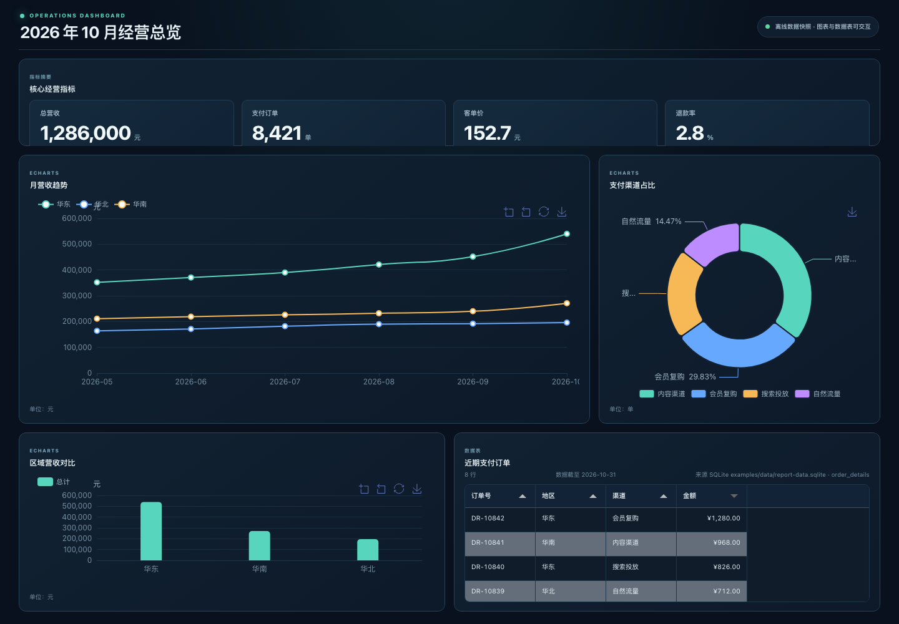
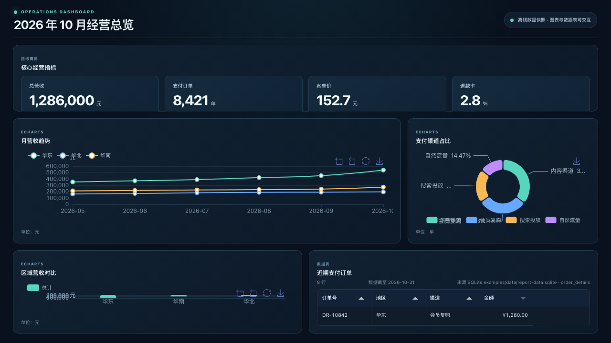
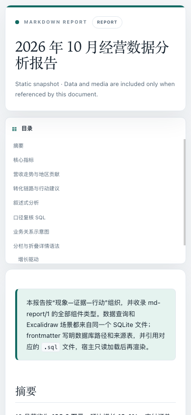
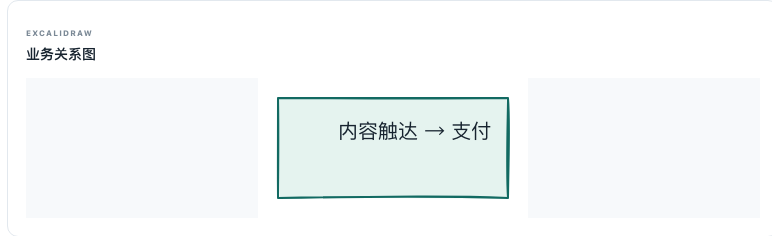

# drender 评审报告 · 功能性 / UI / 数据领域组件缺口

日期：2026-10-18 · 评审对象：本仓库（`md-report/1` 渲染器工作区，`drender`）
未修改任何产品代码。本报告与证据图位于 `reports/20261018-drender-review/`。

---

## 0. 结论摘要

渲染底座（4 个包 + DSH 适配器 + Skill）的工程完成度比上一轮评审时更高：SQLite 只读加载、工作区路径约束、CSP 哈希固定、离线自包含 HTML、5 个渲染引擎按需内嵌，这些都在。当前的问题不在"缺功能"，而在三处：

1. **组件契约是"宽进宽出"的**：Frontmatter 的未知键会被报错，但 `kpi` / `chart` / `data-table` 的未知键被静默忽略。我实测 `{"changeFeild":0.124}`、`{"format":"percent"}`、`{"markLine":{...}}`、`{"exportable":true}`、`{"target":100}` 全部 `valid=true`、无任何诊断，然后**静默丢弃**。也就是说：写错一个字段名，交付出去的是一份看起来正常、其实少了一个指标的报表。
2. **看板的固定布局把内容裁掉了**：`1440×1000` 下 4 张 KPI 卡的环比徽标全部被裁（实测面板底边 234px、徽标底边 257px，被切 23px）。这是"最显眼的位置显示最不完整的信息"。
3. **示例数据与正文数字互相矛盾，且发布的"口径复核 SQL"复现不出报告本身**。这是"能不能放心交付给客户"的问题，比任何视觉效果都严重。

第 3 节给出数据领域建议追加的组件清单；我的判断是：**先补"度量口径层"（不是组件，是让组件可信的前提），再补 6 个真正缺图表类型，最后才是领域专用图**。

---

---

## 修复状态（第二轮，2026-10-18 晚）

用户确认全部修复，并对 5 个不确定项做了决策：未知键报 error、做完整命名指标层、gallery 降级为纯组件图鉴、只修打印 CSS 不引入 PDF 生成、新增组件三层全做。

下表把第一轮的每一条映射到修复结果与验证方式。所有验证都在本机真实执行过。

### 功能

| 编号 | 问题 | 状态 | 验证 |
|---|---|---|---|
| P0-A | 组件未知键被静默忽略 | **已修** | 12 组构造用例：kpi item / chart / axisFormat / combo series / table column / defaultSort / ranking / pivot / findings / provenance / quality / fence 属性，未知键一律 `component.unknown-key` |
| P0-B | 无法表达百分点与业务好坏方向 | **已修** | 新增 frontmatter `metrics`（`format` 含 `percentage-points`、`goodDirection`、`comparison.pointsDelta`）+ KPI item `direction` 绝对覆盖；`changeField` 与 `direction` 现在可共存。实测退款率呈 `-0.6pp` 且 `positive`，华北占比 `-2.3pp` 呈 `negative` |
| P0-C | 示例数字与数据矛盾、复核 SQL 复现不出 | **已修** | `analysis-report.md` 重写为全部经指标层取数：100.7万 / +13.9% / 53.6% / 26.9% / 19.5% / 119.58 / 8,421。新增构建期守卫：示例里每个 `dialect=sqlite` 的 ```sql fence 都会被只读执行，出错或零行即失败（实测 3 条查询分别返回 3/6/3 行）。该守卫当场抓出旧 gallery 里 `date '2026-10-01'` 这条 SQLite 不接受的语法 |
| P1-D | Excalidraw `y="NaN"`、字体不可控、被拉伸 | **已修** | 非法数值属性在导出后清理（实测 `illegalAttrs: []`）；`viewBox` 比例与渲染比例一致（1.93 或 5.97，不再变形）；CSS 覆盖 `font-family`；宿主不再放大；示例场景换成三节点带箭头 |
| P1-E | 把 `format` 当 Tabulator 列选项传入 | **已修** | 改为 `formats` 侧表；控制台不再出现 `Invalid column definition option: format` |
| P1-F | 打印看板图表全空白 | **已修** | 打印媒体实测：图表容器 220px（原 0）、`dashboard` 保持 grid、浅色打印变量生效、打印用 12 列栅格保留各面板 span、加分页规则 |
| P1-G | 数据源适配器静默降级 | **已修** | 10 项全部修复（占位符计数、CSV 全空行、多语句截断、严格数值转换、表头名比对、引号后空白、错误包装、queryFile 两种情况区分、scene maxRows 与迭代器关闭、空结果一致）。42 项断言全过，5 个示例回归通过 |
| P1-1 | 看板 KPI 环比徽标被裁 | **已修** | 首行改为内容驱动 + 卡片最小高度；实测 KPI 内容 203px ≤ 行高 205px，`clippedKpi: 0`（1440/1280/390 三个尺寸） |
| P1-2 | 饼图标签被截断 | **已修** | 标签改为贴边 + 定宽截断；面板矮时隐藏标签只留图例；控制台与截图均无重叠 |
| P1-3 | 末尾 x 轴标签被裁、低高度刻度拥挤 | **已修** | 坐标轴标签走指标格式化（¥120万 而非 600,000）；非条形图加 `boundaryGap`；面板矮时切 compact（刻度降为 3、轴名隐藏、图例置底）；面板设最小高度、放不下时滚动而不是压缩 |
| P1-4 | 移动端首屏被目录占满 | **已修** | `toc: auto` + 最小内联脚本（含 CSP 哈希）：实测 390/700 关闭、1200 展开；摘要标题在各宽度都在首屏内 |
| P2-1 | 交付物混入英文/引擎名、组件标题不可配 | **已修** | 新增 `eyebrow`/`deck`/`status`/`footer`/`theme`，默认改为空（不再注入英文样板）；kicker 默认改中性词并可由 spec `kicker` 覆盖；mermaid/infographic/antv-t8/sql 支持 `title="..."`；图表可加 `anchor` |
| P2-2 | T8 方向符号相反、句子重复 | **已修** | 示例重写（同一句只出现一次、方向与语义一致、数字走 `{{metric}}` token）；新增 T8 `origin=` 与 token 指标不一致的校验 |
| P2-3 | 小字号 | **已修** | 字号用 `max()` 设下限（正文辅助 11.5px、标签 12px、装饰 10.5px）；实测四个示例 × 多视口 `belowFloor: 0` |
| P2-4 | Excalidraw 被拉伸成空白横条 | **已修** | 见 P1-D |
| P2-5 | 可访问性 | **已修** | 每张图表都有视觉隐藏的数据表并被 `aria-describedby` 引用（实测 2/2、9/9、18/18）；Tabulator 表头可 Tab 聚焦、Enter/空格排序、`aria-sort` 与默认排序一致；导出结果进 `aria-live` 区域；补 `prefers-reduced-motion` 与 `prefers-contrast`；导出按钮 ≥30px |
| P2-6 | 主题里的死 CSS | **已修** | 上一代 SVG 图表、`.mdr-sql-keyword`、`.mdr-component-loading` 全部删除 |
| 文档承诺 | 信息图仍请求 AntV CDN 字体并被 CSP 拦 | **已修** | 引导脚本拦截外部样式表插入；控制台从 6 条 CSP 违规降到 0 |

### 新增能力（评审第 4 节，三层全做）

| 层 | 内容 | 验证 |
|---|---|---|
| 第 0 层 | 命名指标层：frontmatter `metrics`（格式、量纲、方向、口径、分子分母、来源、asOf、owner）+ `{{metric_id}}` token（正文 / T8 / 信息图）+ 一致性校验（共享分母的占比之和必须为 1、T8 origin 必须与 token 指标一致） | 占比之和校验、token 未解析、origin 不一致三类用例均按预期报错 |
| 第 1 层 | 新增图表类型 `funnel` / `combo`（双轴）/ `waterfall` / `candlestick`（双栅格 + 成交量）/ `boxplot` / `heatmap` / `sankey` / `treemap` / `radar` / `gauge` / `map`（内联 GeoJSON）；图表可加 `targets` / `bands` / `points` 标注层；新增组件 `ranking` / `pivot` / `sparkline`；表格 CSV / 剪贴板导出 | 12 类图表 + 标注层逐项通过；gallery 18 张图全部出画布、0 错误 |
| 第 2 层 | `findings`（严重度 + metricRef + evidence 锚点 + 行动 + 负责人）/ `provenance`（口径与来源附录）/ `quality`（行数、列数、缺失值、来源、as-of、补充说明） | gallery 与报告均渲染，`findings` 的 `href="#revenue-trend"` 锚点可跳转 |
| 第 3 层 | `heatmap`、`sankey`、`treemap`、`boxplot`、`candlestick`、`radar`、`map` 均落地；`map` 采用内联 GeoJSON（几何随文档走，因此仍离线），真实部署需自备 GeoJSON | 同上 |

### 验证期间新发现并修复的问题

1. **candlestick 让 ECharts 抛异常**：我给它声明了 `gridIndex: 1` 的第二个 y 轴却没有第二个 grid，轴解析失败 → `Cannot read properties of undefined (reading 'type')`。已改为真正的双栅格（价格 + 成交量 + 联动 dataZoom）。
2. **一张坏图会拖垮整页**：该异常在 `initCharts` 的 forEach 里抛出，导致其后 9 张图全部不初始化（gallery 18 张只有 9 张出画布）。已为每张图加独立 try/catch，失败时原位显示错误且不影响其它图。修复后 18/18。
3. **数据源把声明列当投影**：`columns` 声明之外的 SELECT 字段会被静默丢弃（`readRows` 按声明列映射）。已改为"声明列提供元数据与顺序，查询多出的列追加保留"。这个坑是在写指标层时被 `share_east` 全渲染成 `—` 暴露出来的。
4. **`currency:CNY` 与 `currency` + `currency: CNY` 两种写法**：表格列用前者、指标用后者，文档因此写出非法示例。已统一为两种都接受。
5. **`data-table` 不允许 `anchor`、`ranking` 的 `metricRef` 无法使用**：由写 gallery 的过程发现，均已修。
6. **CDP 日志回放**：我的验证脚本误把 Chrome 回放的旧日志当成当前页面的输出，导致一度误判 CSP 问题仍在。已在 harness 里丢弃回放条目后重测。

### 机器化文档校验

`README.md` 与 `SKILL.md` 里共 19 处组件 / frontmatter 示例，全部提取出来喂给真实校验器（忽略依赖数据的诊断码），**0 处结构性非法**。这一项同时抓出了上面第 4 条。

### 仍未做（明确范围外）

- **PDF 生成**：按决策只修打印 CSS；浏览器"打印为 PDF"现在可用（图表不再空白、看板有浅色打印版）。
- **内置中国地图 GeoJSON**：`map` 组件已可用但需作者提供几何；内置资产会显著增大 HTML，单独立项更合适。
- **剪贴板导出**依赖浏览器权限，被拒时自动回退为下载 CSV（已有实测）。
- `stock-dashboard.html`、`data-source-*.html` 由各自脚本生成，`render-examples.mjs` 现在会打印它跳过了哪些示例，不再无声留下陈旧产物。

### 最终验收（四个示例 × 多视口，真实浏览器）

| 页面 | 视口 | scrollWidth | 图表/无画布 | KPI 裁切 | 组件错误 | 空状态 | <10.4px 文本 | 图表可访问数据 | 目录展开 | 表头可聚焦/已排序 | 导出按钮 |
|---|---|---|---|---|---|---|---|---|---|---|---|
| dashboard | 1440×1000 | 1440 | 2/0 | 0 | 0 | 0 | 0 | 2/2 | – | 4/1 | 2 |
| dashboard | 1280×720 | 1280 | 2/0 | 0 | 0 | 0 | 0 | 2/2 | – | 4/1 | 2 |
| dashboard | 390×844 | 375 | 2/0 | 0 | 0 | 0 | 0 | 2/2 | – | 4/1 | 2 |
| analysis-report | 1440×1000 | 1425 | 9/0 | 0 | 0 | 0 | 0 | 9/9 | 展开 | 5/1 | 2 |
| analysis-report | 390×844 | 375 | 9/0 | 0 | 0 | 0 | 0 | 9/9 | **收起** | 5/1 | 2 |
| template-gallery | 1440×1000 | 1425 | 18/0 | 0 | 0 | 0 | 0 | 18/18 | 展开 | 3/1 | 2 |
| data-table-1000 | 1440×1000 | 1425 | 0/0 | 0 | 0 | 0 | 0 | – | – | 15/1 | 2 |

全部页面控制台 0 条消息（含 0 条 CSP 违规、0 条 ECharts 警告）。新增证据见 `evidence/09`–`evidence/15`。

---

## 1. 复核方法与证据边界（第一轮）

- 源码精读：`packages/renderer-core/src/{index,components}.ts`（1538 + 434 行）、`packages/viewer-theme/src/index.ts`（389 行）、`packages/data-sources/src/index.ts`、`plugins/hosts/dsh/src/index.ts`、`.agents/skills/md-report/SKILL.md`。
- 真实浏览器实测：Chrome 155 headless + CDP。**注意**：`--window-size` 在 headless 下有 500px 最小宽度，直接截图会把 500px 布局裁成 390px 造成"溢出"假象；移动端结论全部改用 CDP `Emulation.setDeviceMetricsOverride` 重测，实测 `390px` 视口下 `scrollWidth == 390`，**没有横向溢出**。上一轮评审若用旧方法，移动端溢出结论需作废。
- 逐条实测项：4 个示例 HTML 在 1440/1280/1920/390 下的截图、`screen` vs `print` 媒体下的计算样式、组件级 SVG/画布裁图、控制台日志、以及对 `validateReport`/`renderReport` 的 11 组构造用例。
- 未测：真机 Safari/Firefox、完整 DSH 会话端到端生成、EODHD 网络路径、付款链路。

---

## 2. 功能性问题

### P0-A 组件规格的未知字段被静默忽略（数据可信度问题）

```
实测（renderer-core 0.1.0 构建产物）：
{"items":[{"label":"总营收","value":1286000,"changeFeild":0.124}]}     → valid=true，环比徽标空白
{"items":[{"label":"退款率","value":0.028,"format":"percent"}]}        → valid=true，渲染 "0.03"
{"kind":"line","dataRef":"k","x":"p","y":"v","markLine":{"yAxis":100}} → valid=true，markLine 被丢弃
{"kind":"bar","dataRef":"k","x":"p","y":"v","target":100}              → valid=true，target 被丢弃
{"dataRef":"k","title":"t","exportable":true}                          → valid=true，无导出
```

根因：`packages/renderer-core/src/components.ts:126-150`（KPI）、`:152-234`（chart）、`:236-277`（table）只读取它认识的键，`packages/renderer-core/src/index.ts:1089-1326` 的校验也只校验已知键，两条路径都没有"未知键"检查。对比之下 frontmatter 有 `frontmatter.unknown-key`、SQLite 源有 `sqlite.query-unknown-key`（`index.ts:701-705`、`:539-541`）——同一份文件里两套宽严标准。

影响：Agent 或人手写报表时最典型的错误就是字段名写错/写了一个不存在的功能。当前行为是"照常出图，静默少一块"，读者无从发现。

最小修复：在 `validateComponents` 里为 `kpi`/`chart`/`data-table`/`excalidraw` 各建一张允许键表，未知键报 `component.unknown-key`（error）。

### P0-B 渲染无法表达"百分比点 / 业务好坏方向"

- `components.ts:137`：`direction` 由 `change` 的正负推导。
- `index.ts:1170-1172`：**一旦使用 `changeField`，就禁止声明 `direction`**（实测报 `component.kpi-change-direction`）。

后果：退款率从 3.4% 降到 2.8%（好事）只能显示为红色 `-0.6%` 且无法覆盖。而 `.agents/skills/md-report/SKILL.md:74` 的字段参考表把 `direction` 列为 KPI 可用字段，没有说明它与 `changeField` 互斥——文档与实现不一致，照文档写必然报错。

- `components.ts:145`：`changeText` 恒为 `(change*100).toFixed(1)+'%'`，没有"百分点"语义。同一份数据里 `examples/dashboard.md:65` 把 `-0.006` 当百分点用（表里写"-0.6 个百分点"），而 `examples/analysis-report.md:75` 把同一个指标写成 `value:0.028, unit:'比例'`——同一个字段两种量纲，载荷里没有任何判别位。

最小修复：`changeFormat: "percent" | "percentage-points" | "absolute"` + 允许 `direction` 与 `changeField` 共存（显式声明优先于推导）。

### P0-C 示例数字与数据矛盾，且"口径复核 SQL"复现不出报告

以 `examples/data/report-data.sqlite` 为准（华东 540,000 / 华南 271,000 / 华北 196,000，10 月合计 1,007,000；9 月 884,000；订单 8,421）：

| 位置 | 正文写的 | 数据推出的 | 偏差 |
|---|---|---|---|
| `analysis-report.md:64,104,138`；`template-gallery.md:64,112,146`；KPI `:75`；`dashboard.md:65` | 10 月营收 **128.6 万** | **100.7 万**（1,007,000） | +27.7% |
| `analysis-report.md:104` / `template-gallery.md:112` | 9 月营收 114.4 万 | **88.4 万**（884,000） | +29.4% |
| `analysis-report.md:64,104,138` 等 | 环比 **+12.4%** | **+13.91%** | −1.51pp |
| `analysis-report.md:96,139` / `template-gallery.md:104,147` | 华东贡献 **42%** | **53.62%**（540,000/1,007,000） | −11.6pp |
| `analysis-report.md:75,106` / `dashboard.md:65` | 客单价 **152.7 元** | **119.58 元**（1,007,000/8,421） | −33.1 元 |
| `analysis-report.md:138` / `template-gallery.md:146`（T8 叙述） | "华东区的 10 月营收为 128.6 万元"，且重复了同一句结论 | 华东 = **54.0 万**；句子重复 | 归因错误 + 重复 |
| `analysis-report.md:64,75,107,139-140,175` 等 | 退款率 3.4%→2.8%、"−0.6 个百分点" | **声明的数据集里没有任何退款字段**；唯一"已退款"数据是 250/1000 = 25% | 无来源 |
| `analysis-report.md:145-154` | 作为"口径复核 SQL"发布 | 运行结果是华东 3,387/4 单/846.75，与图表中的 540,000/3,537 差约 160 倍 | 复核即打脸 |

关键：`1,286,000` 是伪造的枢纽——`540000/1286000 = 41.99%`（→"42%"）、`1286000/8421 = 152.71`（→"152.7"）、`1286000/1144000−1 = 12.4%`（→环比）。一个错误的合计派生出另外三个错误数字，而且彼此自洽，所以肉眼很难发现。9 月那一列（7,747 单 / +8.7% / 147.7 元）同样自洽但无任何数据来源。

`analysis-report.md` 与 `template-gallery.md` 的正文约 90% 相同（含全部错误数字），因此示例集没有独立的交叉验证路径。真正干净的只有 `dashboard.md`（全部走 `dataRef`，正文零手写数字）——**这恰好说明正确做法已经在代码里支持了，只是示例没有照着做**。

### P1-D Excalidraw 导出的 SVG 含非法属性 + 字体不可控 + 判定为"原始尺寸不移位"

实测导出的 SVG（`analysis-report.html` 内联）：

```html
<svg class="mdr-excalidraw-svg" height="140" width="270" viewBox="0 0 270 140" ...>
  <text ... font-family="Segoe UI Emoji" y="NaN" x="0">内容触达 → 支付</text>
```

- `y="NaN"`：这是浏览器会报错的非法属性值（控制台 `Error: <text> attribute y: Expected length, "NaN".`）。根因是 Excalidraw 在 `linkedom` shim 下拿不到文本度量（`packages/renderer-core/src/index.ts:54-127` 只补了 `Image`/`fonts`，没有 `getComputedTextLength`/`measureText`）。
- `font-family="Segoe UI Emoji"`：Windows 字体名写进了离线产物，中文在不同机器上会落到不同回退字体——与"自包含、可复现交付"的承诺冲突；同时 `<style class="style-fonts">` 是空的（`skipInliningFonts: true`），手绘字体并没有随文件走。

### P1-E 表格把非 Tabulator 选项传给了 Tabulator

`components.ts:256` 生成 `{ format: column.format }` 作为列定义，但 Tabulator 的对应选项是 `formatter`。实测控制台稳定输出：

```
[console:warning] Invalid column definition option: format
```

格式化结果目前由自定义 `formatter` 兜住所以没出错，但这是每次渲染都会出现的实现破绽。

### P1-F 打印一份看板 = 图表全空白

`viewer-theme/src/index.ts:383` 的打印规则 `.mdr-content .mdr-dashboard { display: block }` 把网格布局改成块级，而 `:317` 的 `.mdr-dashboard-page .mdr-echart { flex:1; height:auto; min-height:0 }` 依赖 flex 上下文。实测（CDP 打印媒体）：

| | `.mdr-dashboard` display | 三个图表容器高度 |
|---|---|---|
| `screen` | `grid` | 272 / 272 / 149 px |
| `print` | `block` | **0 / 0 / 0 px** |

同时 `:375` 的打印规则只覆盖 `:root`/`[data-theme]`，而深色变量由 `body.mdr-dashboard-page`（`:256-273`）以更高优先级声明，所以看板打印出来仍是大面积深色底（耗墨且不像正式交付物）。附带发现：打印时 KPI 环比徽标反而不再被裁（因为块级下高度自适应）。

### P1-G 数据源适配器的静默降级

`packages/data-sources/src/index.ts`：

- `:185-188`、`:251`、`:347`：占位符个数与 `parameters` 不匹配时，未绑定的 `?` 变成 NULL；若声明了 `columns`，结果是**空的 rows 且没有任何错误**（实测）。配置写错会交付一份全空的报表。
- `:45`：`row.some(v => v.length > 0)` 会静默丢掉全空行（实测 `a,b\n1,2\n,\n3,4\n` → 只剩 2 行）。
- `:182`/`:264`：`database.prepare(sql)` 会静默丢弃第一条语句之后的所有内容（实测 `SELECT 1 AS a; DROP TABLE …;` 返回 1 行、无报错）。只读保护本身有效（`WITH … INSERT` 抛 "attempt to write a readonly database"），但"多语句被无声截断"值得显式拒绝。
- `:94`：`Number(value)` 让空白字符串变成 `0`（应为 null），`'0x10'` 变成 16。
- `:124`：只比较表头字段**个数**，从不比较表头名字。

### P2 其他

- `examples/render-examples.mjs:10` 只重新生成 6 个示例中的 4 个；`data-source-csv.html` / `data-source-sqlite.html` 已经落后于当前渲染器。
- `sync-stock-example.mjs` 的 `--offline` 在缓存过期时静默使用陈旧数据（实测 2 天缓存 + 18h TTL，只打印一行提示后照常出图）。
- `.gitignore` 忽略了 `examples/.cache/` 但没有忽略 `examples/data/`，`*.sqlite-shm` / `-wal` 出现在工作区里。
- `/tmp` 之外无 PDF 出口：`md_report_render` 只交付 HTML；而 HTML 的打印路径当前是坏的（见 P1-F），所以"稳定 PDF 交付"实际上不存在。

### DSH 适配器（`plugins/hosts/dsh/src/index.ts`）与 Skill

这一层整体是本次评审里工程质量最好的部分，先说验证到的优点，再说两处契约不一致：

- 路径约束用的是 DSH 的 `fs.contains(root, target)`（`:238`、`:536`），不是自己拼字符串；Markdown 1MB、query file 100KB、SQLite 512MB、单图 8MB、图片总量 8MB 都有独立检查（`:219-400`）。
- 失败状态是**诚实**的：`status` 有 `invalid` / `rendered` / `storage-failed` 三态，保存产物失败时会明确说"HTML 渲染成功但没有绝对路径"，而不是返回一个假的成功（`:722-743`）。
- `plugins/hosts/dsh/lib/skills/md-report/SKILL.md` 由 `scripts/package-dsh-skill.mjs` 从 `.agents/skills/md-report/SKILL.md` 复制生成；实测两份 **17459 字节完全一致**，无漂移。

两处文档与实现不一致（都会让照文档写的 Agent 直接踩坑）：

| 文档 | 实现 | 后果 |
|---|---|---|
| `SKILL.md:74` 把 `direction` 列为 KPI 通用可选字段 | `index.ts:1170-1172` 在同时使用 `changeField` 时报 `component.kpi-change-direction`（实测） | 按文档写 → 校验直接失败 |
| `SKILL.md:75` "Container height is **320 px** in a report" | `viewer-theme/src/index.ts:192` `.mdr-echart { height: 250px }`（实测 `.mdr-chart` 352px，其中画布 250px） | 按文档估算排版/配图比例会偏 |

另外 `assets` / `datasets` 两个入参在 tool schema 里是 `additionalProperties: true` 的透传（`:159-168`），实际契约只在渲染器里校验、只写在 Skill 里。可用，但意味着工具本身无法在调用前拦住一个形状错误的 dataset。

### 已验证正常（避免误报）

- SQLite 只读连接真正拦截写操作；工作区路径约束（`fs.contains`）有效；CSP 哈希固定、无 CDN 依赖（唯一的例外见下）。
- `node examples/render-examples.mjs` 退出码 0、零警告，逐字节复现 4 个已提交 HTML。
- Mermaid / AntV Infographic / T8 / Excalidraw / 6 个 ECharts 图表 / Tabulator 在 `template-gallery.html` 中全部真正渲染（`componentErrors = []`），无崩溃。
- 检查了 4 个示例 × 5 个视口：除下述问题外没有横向溢出、没有零高度图表、没有脚本被 CSP 拦掉。

### 一个与文档承诺冲突的发现

README 与 SKILL.md 都声明"导出的 HTML 不请求 CDN、离线可用"。实测 AntV Infographic 运行时会去请求 `https://assets.antv.antgroup.com/AlibabaPuHuiTi-Regular/result.css` 等 6 个字体样式表，被 CSP `style-src 'unsafe-inline'` 全部拦掉，控制台每次渲染固定输出 6 条 CSP 违规。结论是"离线可用"目前靠 CSP **阻断**来成立，代价是信息图排版使用了非预期回退字体，且每个交付文件都带 6 条错误日志。

---

## 3. UI / 设计问题

证据图：`evidence/01`–`evidence/08`。

### P1-1 看板 KPI 的环比徽标在桌面端全部被裁

`.mdr-dashboard { grid-template-rows: 140px minmax(0,1.5fr) minmax(0,1fr) }`（`viewer-theme:302`）+ `.mdr-panel { overflow: hidden }`（`:303`）。第一行硬编码 140px，而 KPI 卡内容需要约 165px。

实测（1440×1000）：面板底边 234px，环比徽标底边 257px，`clipped: true` × 4。见 ——四张卡只有标签和数值，"+12.4% 环比"整体不可见。390px 移动端因为 `min-height: 240px` 反而正常，所以这个问题只在"演示和交付最常用的桌面尺寸"上出现。

修复：把第一行从固定 `140px` 改为 `minmax(140px, auto)`，或者给 `.mdr-panel` 一个 `min-height` 并把 `overflow` 改成 `visible`（`grid-template-rows` 硬编码三行本身也是脆弱契约：写第四行面板或把非 KPI 面板放第一行就会得到同样后果）。

### P1-2 饼图外部标签被截断

1440 的 466px 面板里，标签渲染成"内容…"、"搜索…"，390 下"自然流量 1…"。`components.ts:174-180` 的 `label: { formatter: '{b}  {d}%' }` + `avoidLabelOverlap` + `radius:['42%','70%']`（对 466px 宽的面板偏大）没有给标签留位置。见 。

修复：窄面板改用图例承载数值（`legend` 带百分比、`label.show:false`），或给 label 加 `width` + `overflow:'break'` + 收紧 `radius`。

### P1-3 坐标轴标签被画布裁掉 / 低高度下刻度拥挤

- 最后一个 x 轴标签被裁成 `2026-1(`（1440 与 1280 都可见）。`components.ts:216` 的 `grid.right: 20` 对"居中在最后一个数据点上"的末尾标签不够。
- 1280×720 下第三行面板绘图区被压到约 90–120px：y 轴 7 个刻度互相挤、图例色块与 `单位/轴名` 重叠、柱体被裁。见 。

修复：给定最小绘图区高度并允许面板内部滚动，而不是继续压缩；末尾标签加 `boundaryGap`/`align` 或增大右内边距。

### P1-4 移动端首屏是目录，不是摘要

报告模式下 TOC 是 `<details class="mdr-toc" open>`（`renderer-core/src/index.ts:1510`），移动端仅改成 `position: static`（`viewer-theme:328`）**没有收起**。390px 实测：目录占 y=228→540，正文第一句"摘要"要到 y≈790。见 。

修复：`open` 只在 `min-width: 900px` 生效（或用 CSS 媒体查询 + `details` 的 `open` 属性配合 JS，或干脆在窄屏改为"跳转到…"折叠条）。

### P2-1 交付物里混进了英文/工程占位文案（硬编码，不可覆写）

- `index.ts:1462` 报告页副标题固定为 `Static snapshot · Data and media are included only when referenced by this document.`——中文报告里出现英文样板，且 `frontmatter` 没有 `deck`/`subtitle` 可覆写。
- `index.ts:1467` 页脚固定 `Rendered with md-report/1 · Interactive charts and tables · This file works offline.`
- `index.ts:1450` 看板固定 `OPERATIONS DASHBOARD` + `离线数据快照 · 图表与数据表可交互`。
- 组件 kicker 固定暴露引擎名：`ECharts` / `Mermaid` / `AntV Infographic` / `AntV T8` / `Excalidraw`（`components.ts:233,295,301,306,314`）。图鉴类文档合适，但同一套渲染器产出的客户报告里，`ECHARTS` 占据每张图的标题上方（7.875px 小字，见 P2-3）。
- 图例/叙述之外，`excalidraw` / `mermaid` / `infographic` / `antv-t8` 的标题是硬编码的（"业务关系图"/"流程图"/"信息图"/"分析叙述"），**无法按块自定义**：一份报告里两张流程图会都叫"流程图"。

修复：frontmatter 增加 `deck`/`footer`/`eyebrow`/`statusText`；组件 kicker 改由 spec 的 `kicker` 控制，默认不显示引擎名（或只在 `mode: gallery` 显示）。

### P2-2 T8 叙述的方向符号与语义相反，且句子重复

`evidence/06`：正文"退款率下降至 **▲2.8%**"——下降配了上箭头。同一段最后一句"退款率下降至2.8%，但华南区仍是复核重点。"原样出现两次（`analysis-report.md:139-140`）。数字问题见 P0-C。

### P2-3 小字号偏小

实测：KPI 环比徽标 9.625px、KPI 标签 10.5px、图表单位注 9.625px、组件 kicker 7.875px。同页小于 12px 的可见文本约 78–82 处。信息图/表格里的辅助说明是真实内容而非装饰，10px 以下在打印和投屏上不可读。

### P2-4 Excalidraw 组件被拉伸成空白横条

`viewer-theme:242` 的 `.mdr-excalidraw-svg { width:100%; min-width:460px; max-height:560px }` 只覆盖宽度，SVG 的 `height="140"` 属性仍然生效。带 `viewBox="0 0 270 140"` 的 270×140 场景被放进 734×140 的视口，`preserveAspectRatio` 取 `meet` → 内容按 1:1 居中，两侧留出大片空白背景。见 。对比 Mermaid 的规则（`:234` 用了 `height: auto`）本来是对的。

修复：`.mdr-excalidraw-svg { width:auto; max-width:100%; height:auto }`，并给宿主一个最小高度，避免小场景被放大成整屏。

### P2-5 可访问性

- ECharts 画布只有 `role="img"` + `aria-label="<图表标题>"`，无任何数据可读路径，也没有视觉隐藏的等价数据表。屏幕阅读器只能听到图名。
- Tabulator 表头实测 `role="columnheader"` 但 `tabindex=null` → **键盘无法到达**，无法排序；且默认排序（金额降序）时 `aria-sort` 仍是 `"none"`，与视觉上的 ▼ 不一致。
- `prefers-reduced-motion` / `prefers-contrast` 无任何适配。
- 主题只有 `data-theme="auto"`，产物内没有明暗切换控件（`data-theme` 由渲染器写死），作者无法为特定交付锁定浅色。

### P2-6 主题里有一整块上一代图表实现的死代码

`viewer-theme/src/index.ts:191-207`（`.mdr-chart-svg` / `.mdr-chart-legend` / `.mdr-chart-series` / `.mdr-chart-gridline` / `.mdr-chart-label` / `.mdr-chart-line` / `.mdr-chart-point` / `.mdr-chart-center` / `.mdr-chart-center-value` / `.mdr-chart-layout--pie`）、`:233`（`.mdr-sql-keyword`）、`:237`（`.mdr-component-loading`）都没有任何代码会产出对应 DOM。另有 `:194-195,363-364` 仍在媒体查询里引用这些选择器。建议连同 `viewer-theme` 一起清掉，否则每次改主题都要在"看起来有效其实无效"的规则里做判断。

### 关于官网（`sites/drender-official/dist/index.html`）

视觉自成一派（深底荧光绿、粗衬线大标题、倾斜装置图），信息层级和动效克制都合格，是一个像样的 Persuade 表面，**不需要重做**。值得注意的一点：官网首屏装置图里的数字（月营收 ¥1.01M、环比 ↗13.9%、华东贡献 53.6%、¥540,000）恰好是**修正后**的正确值，而已提交的示例仍是 128.6 万 / 12.4% / 42%。也就是说数字在官网被修好了，但示例产物没有跟上——建议把"示例数字与数据一致"做成构建期检查，否则这两处会长期互相矛盾。

---

## 4. 数据领域需要追加哪些渲染组件

现状（`components.ts:325-335`、`:427-429`）：`kpi`、`chart`(line/bar/column/area/scatter/pie)、`data-table`、`sql`、`mermaid`、`infographic`、`antv-t8`、`excalidraw`，加上容器类 `dashboard`/`panel`/`note`/`warning`/`success`/`column`/`details` 与自动目录。

关键结构判断：**`chart` 是一个封闭 schema**。`renderChart` 从 `kind/x/y/series/unit/title` 重新构造 ECharts option（`components.ts:166-230`），没有 option 透传口子。所以"双轴""目标线""瀑布"这类需求目前**无法用任何写法表达**——这也是上面 `markLine`/`target` 被静默丢弃的原因：不是忘了渲染，是设计上就没有这个入口。

因此建议按四层推进，而不是直接堆图表类型。

### 第 0 层：度量口径层（前提，不是组件）

不先做这一层，下面每加一个组件都会继承 P0-B / P0-C 的同一个病。做法是 frontmatter 增加 `metrics`，把"一个业务指标"变成有名字、有量纲、有方向、有口径的对象，组件只引用它：

```yaml
metrics:
  oct_revenue:
    label: 10 月营收
    value: 1007000          # 或 dataRef + field
    format: currency        # currency | percent | percentage-points | number | compact | ratio | duration
    currency: CNY
    decimals: 2
    compact: true           # 100.7 万 / 1.01M
    unit: 元
    goodDirection: up       # 决定颜色，与数值升降解耦
    comparison:
      kind: mom             # mom | yoy | target | none
      baseline: 884000
      asPercent: true
      pointsDelta: false
    definition: 按已支付订单金额汇总，含税，剔除内部结算
    numerator: null
    denominator: null
    source: 交易库 order_details
    asOf: 2026-10-31
    owner: 经营分析组
```

组件改成 `{"metricRef":"oct_revenue"}`。收益是三重的：
1. **一致性可校验**：有了 `numerator`/`denominator`/`baseline`，校验器可以真的检查"占比之和是否为 1""环比是否等于 value/baseline−1""KPI 与图表是否引用了同一个值"。当前这些只能靠人眼，而人眼已经失守了（P0-C）。
2. **数字与散文同源**：`antv-t8` 和正文里的数字改为引用同名指标，示例里"正文 128.6 万 / T8 128.6 万 / KPI 1,286,000"三处一致但都错的局面就不会出现。
3. **格式语义落地**：`percent`（0.028→2.8%）、`percentage-points`（−0.006→−0.6pp）、`compact`（1,007,000→100.7 万）、`currency` 一次性解决，而不是每个组件各自 `Intl.NumberFormat`。

### 第 1 层：真正缺的常规经营图（优先级最高）

| 组件 | 回答什么问题 | 引擎 | 形态 | 为什么现在做不了 |
|---|---|---|---|---|
| `funnel` | 转化在哪个环节掉了 | ECharts `funnel` / 居中条形 | 新增 kind | SKILL.md:75 明确写"`funnel` is not supported"，示例只能用 Mermaid 手画漏斗（`analysis-report.md` 正是这么绕的） |
| `combo`（双轴/混合） | 量价关系（营收柱 + 毛利率线） | ECharts 多 yAxis | `y` 扩展为 `[{field,type,axis,stack}]` | 当前 `y` 必须是单个字符串（实测传数组报 `component.chart-field`） |
| `waterfall` | 从期初到期末，各因子贡献多少 | ECharts bar + 透明基座 | 新增 kind | 高层月报最常被要的一张图，当前只能用堆叠柱手搓 |
| `target`/`reference`（不是新组件，是 chart/KPI 的字段） | 达成率、预算线、上期线、均值线 | ECharts `markLine`/`markArea`/`gauge` | 扩 schema | `markLine`/`target` 现在被静默丢弃 |
| `pivot`（交叉表） | 地区×月份、渠道×品类 | Tabulator / 自渲染矩阵 | 新增组件 | 只能用 SQL 预先把数据透视成长表，表头双轴信息丢失，移动端横向滚动体验差 |
| `ranking`（排行条） | 前 10 是谁、差多少 | 纯 HTML/CSS | 新增组件 | 用柱状图代替 10 个条目：可读性更差、移动端轴标签全挤在一起、还占 250px 高 |
| `sparkline` + `delta`（KPI/表格内嵌） | 这个指标最近在往哪走 | 内联 SVG / ECharts 微型实例 | 扩 kpi + table column | 现在看趋势必须单开一张 250px 的图；"一眼看 12 个指标的趋势"做不到 |

### 第 2 层：把图表变成证据（差异化的关键）

| 组件 | 作用 |
|---|---|
| `annotations`（chart/时间轴上的标注） | `markLine`（目标/预算/上期）、`markArea`（大促、故障、口径变更区间）、`markPoint`（极值）、锚定到某个数据点的文字结论。这是"现象—证据—行动"里"证据"的落点。 |
| `findings`（结论卡） | 带 `severity`、`metricRef`、`evidence: [componentId]`、`action`、`owner`。渲染成可点击的锚点，点结论高亮对应图表与区间。示例正文宣称按"现象—证据—行动"组织，但实际只有 `::: success` 提示框，没有可交互的证据链。 |
| `provenance`（口径与来源卡） | 机器可读的：口径定义、分子分母、过滤条件、剔除范围、as-of、刷新频率、责任人。渲染为指标旁的小 `ⓘ` 与统一脚注。这是让"可否放心引用"变成产品功能的地方。 |
| `quality`（数据质量面板） | 行数、覆盖窗口、缺失字段、未纳入范围。当前 `dataset.empty`/`dataset.unused`/`dataset.reference-missing` 这些诊断**只发给作者，从不进入产物**，读者看不到"这份报告可能少了什么"。 |

### 第 3 层：领域专用（按需，不值得先做）

| 组件 | 说明 |
|---|---|
| `heatmap` / 日历热力图 | 留存、时段×星期活跃度 |
| `sankey` / `sunburst` / `treemap` | 多级流向与多分片构成。饼图超过 5 片就不该用了，目前没有替代品 |
| `boxplot` / `histogram` | 分布与异常审查（客单价、金额分布）。`scatter` 替代不了 |
| `candlestick` + 成交量 | 本仓库自带股票看板，却没有 K 线；`stock-dashboard.md` 只能画收盘价折线 |
| `radar` | 多维度评分对比（渠道能力、门店评分卡） |
| `map` | 区域经营报告的中国地图。价值高但需要 geoJSON 资产与离线内嵌，且直接冲击 12MB HTML 上限，建议作为独立一轮评估 |
| `gantt` / 时间轴 | 已有 Mermaid `gantt` 覆盖，优先级最低 |

### 第 4 层：交付能力（属于"数据领域"的另一半）

1. **表格导出**：Tabulator 的 download 模块已经在打包里，但没有入口。`{"exportable":true}` 现在被静默忽略（实测）。加 CSV / 剪贴板导出即可，成本极低、感知很强。
2. **打印/PDF**：先修 P1-F（打印时图表 0 高度），再补分页控制、封面、以及看板的浅色打印模式。现在"导出一份 PDF 交给客户"这条路是断的。

### 建议不要做的

- **不要再加图解引擎**。已有 3 套（Mermaid / Infographic / Excalidraw），且都没有"按块自定义标题"这种最基本的控制（P2-1）。再加只会继续稀释。
- **不要把裸 ECharts option 透传当成主入口**。它会同时击穿 CSP 哈希固定、离线确定性和校验能力这三条现有优势。但建议开一个**白名单覆盖对象**（只允许 `markLine`/`markArea`/`markPoint`/`yAxis[1]`/`grid`/`dataZoom`），并纳入校验，避免"想调一个轴就要改渲染器源码"。
- 实时数据连接、可视化编辑器、大而全数据接入——与当前"离线快照 + 可复核源文件"的定位相冲突。

---

## 5. 建议的修复顺序

**第一批（可信交付，1–2 天量级）**
1. 组件规格未知键报错（P0-A）。
2. `format`/`percentage-points`/`direction` 与 `changeField` 解耦（P0-B），同步修 SKILL.md:74。
3. 修示例数字与"口径复核 SQL"，让正文数字改为引用命名指标；给两个示例做一次独立的数字校验（P0-C）。
4. 表格不再把 `format` 传给 Tabulator（P1-E）；Excalidraw SVG 的 `height:auto` + `y="NaN"`（P1-D、P2-4）。

**第二批（交付品质）**
5. 看板首行 `minmax(140px, auto)`，KPI 环比可见（P1-1）。
6. 打印路径：图表不再 0 高度，看板加浅色打印（P1-F）。
7. 图表末尾标签/窄面板饼图标签/低高度绘图区（P1-2、P1-3）。
8. 移动端目录默认收起；`deck`/`footer`/kicker 可配置（P1-4、P2-1）。

**第三批（数据领域扩展）**
9. 度量口径层（第 0 层）——先于任何新图表。
10. `funnel` + `combo` + `waterfall` + 参考线/目标线（第 1 层的前四项）。
11. 表格导出 + `findings`/`provenance` 组件。

**第四批（按需）** 第 2、3 层的其余组件；先看第 0 层落地后，哪些需求能被已有组件 + 指标层满足。

---

## 附：证据图索引

| 文件 | 内容 |
|---|---|
| `evidence/01-dashboard-1440x1000-kpi-clipped.png` | 1440×1000：4 张 KPI 的环比徽标全部不可见；饼图标签截断为"内容…""搜索…"；末尾 x 轴标签裁成 `2026-1(` |
| `evidence/02-dashboard-1280x720-axis-crowding.png` | 1280×720：第三行面板绘图区被压到约 90–120px，刻度拥挤、图例与轴名重叠 |
| `evidence/03-dashboard-390-mobile.png` | 390×844（CDP 真实视口）：KPI 环比正常，无横向溢出 |
| `evidence/04-report-390-toc-before-summary.png` | 390×844：目录占据整个首屏，摘要被推到 y≈790 |
| `evidence/05-excalidraw-letterboxed.png` | Excalidraw 组件：270×140 场景被放进 734×140 视口，两侧空白；导出含 `y="NaN"` |
| `evidence/06-t8-wrong-numbers-dup-sentence.png` | T8 叙述：华东营收写成 128.6 万（应为 54.0 万）、"下降"配 ▲、末句重复 |
| `evidence/07-dashboard-print-blank-charts.png` | 打印媒体：三个图表容器高度 0 |
| `evidence/08-site-1440.png` | 官网桌面（数字已是修正后的 1.01M / 13.9% / 53.6%） |
| `evidence/09-fixed-dashboard-1280x720.png` | 修复后 1280×720：KPI 环比可见、坐标轴格式化、目标线、饼图无重叠、面板不压缩 |
| `evidence/10-fixed-dashboard-1440x1000.png` | 修复后 1440×1000：KPI 徽标完整、axisFormat 生效、排行与导出按钮 |
| `evidence/11-fixed-candlestick-dual-grid.png` | 新增 K 线：价格栅格 + 成交量栅格 + 联动缩放 |
| `evidence/12-fixed-excalidraw-natural-size.png` | Excalidraw 修复后：三节点流程、比例正确、无 NaN |
| `evidence/13-new-pivot-cross-tab.png` | 新增交叉表：双轴表头 + 行列合计 + 货币格式化 |
| `evidence/14-new-ranking.png` | 新增排行：条形 + 数值 + 占比 |
| `evidence/15-new-quality-panel.png` | 新增数据质量面板：行数/列数/缺失值/来源/截至 |
